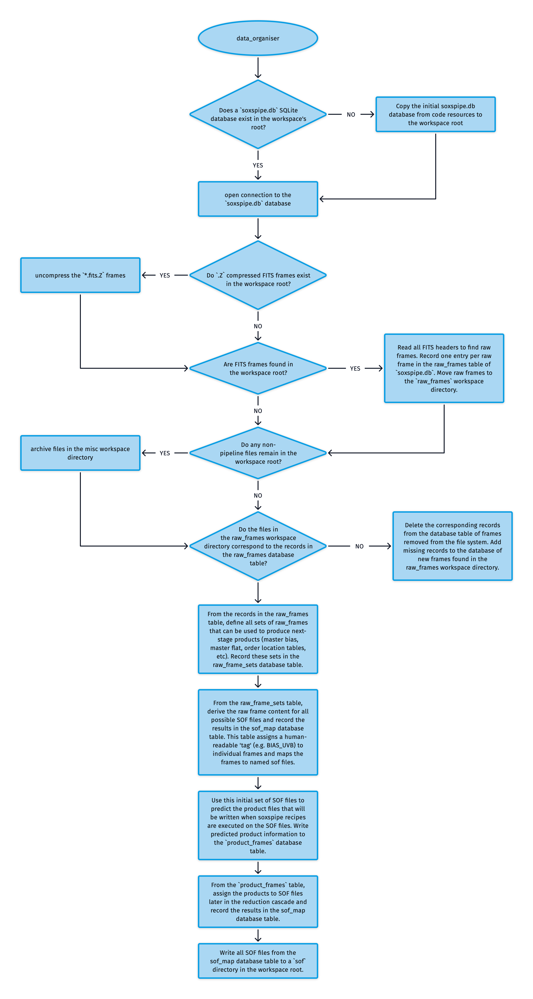

# Data Organiser

The data organiser (DO) is the backbone of the pipeline. It is required to sort and prepare data within a workspace, predict which products will be produced during data reduction, write out all of the [set-of-files (SOF)](../utils/set_of_files.md) files required by each of the soxspipe recipes and keep track of all data-products generated during the reduction cascade. The DO also provides functionality to rewrite SOF files on the fly if a recipe fails to produce a product required by a future recipe (e.g. a master flat frame), switching out the failed product for the next-best product (e.g. the next master flat frame generated closest in time to the recipe data). Finally, on subsequent executions of the pipeline, the organiser prevents data from being re-reduced if the products already exist (unless the user chooses to override this feature).

The algorithm the DO uses to prepare a workspace is shown in {numref}`data_organiser_util`.

:::{figure-md} data_organiser_util
{width=600px}

The algorithm used by the soxspipe data-organiser to prepare a workspace for data reduction.
:::

At the heart of the DO is a SQLite database called `soxspipe.db`. Here, the organiser's bookkeeping is performed, recorded, and maintained.

The ESO Science Archive Facility delivers FITS data in a `.fits.Z` compressed format. The DO does not uncompress these frames and does not need the system `uncompress` command. They stay compressed on disk, and astropy reads them directly. This needs astropy 7.2 or later with the `uncompresspy` package, which soxspipe installs.

When you run `soxspipe prep`, the DO finds all `.fits` and `.fits.Z` frames in the workspace root and anywhere in the `raw` directory tree. The `.fits` suffix can be in any letter case (for example `.FITS`). The `.Z` must be an upper-case `Z`. The DO then reads the FITS headers of these frames and selects out the raw (unreduced) frames, recording one entry per raw frame in the `raw_frames` table of `soxspipe.db`. A compressed frame is recorded with its `.fits.Z` name. The DO then moves raw frames from the workspace root to a `raw/<night>/` directory, still compressed. Any remaining files are moved out of the workspace root and into a `misc` directory.

If a frame exists in both forms, the compressed one is kept. This applies when `X.fits` and `X.fits.Z` are in the same directory, and when a `X.fits` in the workspace root has a `X.fits.Z` that is already in the database. In both cases the DO deletes `X.fits`. The DO never deletes an uncompressed frame that is itself recorded in the database.

SOF files list compressed frames with their `.fits.Z` name (for example `./raw/2024-01-01/X.fits.Z`), and the recipes read them in place. Frames that the recipes prepare from a `.fits.Z` input are saved without the `.Z`. For example, `X.fits.Z` gives `X_pre.fits`. No output file name carries `.Z`.

A sanity check is performed to ensure that the data in the `raw_frames` database table matches the data in the `raw` directory. If frames have been removed from the file system, the corresponding records in the database table are deleted. Also, frames within the `raw` directory missing from the database table are added.

The next step is for the DO to define all sets of raw frames that can be used to produce next-stage products (master bias, master flat, order location tables, etc). The rules for these associations are read from the `soxs_sof_map.yaml` file is shipped with the pipeline code. These sets are recorded sets in the `raw_frame_sets` database table. These raw frame sets derive the raw frame content for all possible SOF files, which are recorded in the `sof_map` database table, assigning a human-readable 'tag' (e.g. BIAS_UVB) to individual frames and mapping the frames to named sof files. 

The initial set of SOF files in the `sof_map` table is used to predict the product files written when soxspipe recipes are executed on the SOF files. The expected product information is written to a `product_frames` database table. From this `product_frames` table, products are assigned to SOF files later in the reduction cascade (recorded again in the `sof_map` table). 

Finally, all SOF files from the `sof_map` table are written to a sof directory in the workspace root and are ready to be used by the various soxspipe recipes during a data-reduction session.

During the running of each pipeline recipe, Quality Control (QC) metrics are generated, and within the pipeline settings file, there are `qc-acceptable-ranges` for each recipe. These acceptable ranges act as guardrails for the pipeline, so that if a QC metric falls outside an acceptable range, the pipeline forces a 'fail' on this data, preventing it from cascading into further data-reduction stages.

### Late-arriving frames

A raw frame can reach the workspace after its set was grouped, for example when the last exposures of a template run are downloaded later. On a plain `soxspipe prep`, the DO adds such a frame to the existing set instead of creating a second set.

A late frame is a raw frame that is not yet processed and is in no SOF. It joins an existing set when both of these are true:

- It has the same value as the set's frames for every grouping key.
- It has the same `eso tpl start` value, so it comes from the same template run.

When a late frame joins a set, the DO does these things in the same `prep` run:

1. The set keeps its SOF name. The new SOF file is written under the old name.
2. The status of the set's products is reset to NULL in every session, so each session queues the set to run again.
3. The set's stale product file and its `_ERROR.log` file are deleted. This happens at `prep`, not at `reduce`.
4. The DO prints a line that names the SOFs that gained late frames.

A frame from a different template run has a different `eso tpl start` value. It does not join the set and forms a new SOF.

The DO does not add a late frame to a set in these cases:

- The frame has no `eso tpl start` value.
- The frame comes from a technique that the DO groups one exposure at a time (`ECHELLE,SLIT,STARE`, `ECHELLE,PINHOLE` and `ECHELLE,MULTI-PINHOLE`).
- The frame is an NIR `IMAGE` frame that is not a `DARK`. The grouping leaves these frames out.

#### Limits

- Only the current session's `sof_map` rows for the set are removed. The other sessions keep their own `sof_map` rows for the set, although their statuses are reset.
- Products that are downstream of the rejoined set are not queued again. This is tracked as DY-264.
- The SOF name is kept for one `prep` run only. The name is held in memory. If the set is still unprocessed when the run ends (for example, while a calibration is missing), a later `prep` names the set after its earliest frame.
- `soxspipe prep --refresh` rebuilds the database and groups all frames again. It does not keep the old SOF names in this way.

### How calibrations are matched

Each product SOF that is not yet complete needs calibration products from earlier recipes in the cascade. The DO picks them with one rule per calibration type, defined in `CALIBRATION_RULES` in `soxspipe/commonutils/calibration_matching.py`. This section is for users who want to know why a SOF lists a given calibration.

Every time the DO builds the SOF files, it refreshes the `calibration_matches` table in `soxspipe.db`. The `cal_<type>` views read this table.

#### Rules common to every type

An upstream product is a candidate for a SOF only when all of these are true:

- It has the same arm as the SOF.
- Its recipe comes earlier in the cascade (it has a lower `recipe_order`) than the recipe of the SOF.
- It is complete and its status is `pass` or empty.
- It has an `mjd-obs` value. The SOF also needs one, and the SOF must not be complete.

A blank value never matches. For example, a SOF with no slit value matches no upstream product under a rule that compares slits.

The DO ranks the candidates by the distance between their `mjd-obs` and the `mjd-obs` of the SOF, nearest first, and keeps the number set for the type. The `mdark` type ranks by exposure time first. If two candidates are at the same distance, the DO keeps the one with the earlier upstream `mjd-obs`. If those are equal too, it keeps the one that comes first by `filepath`. Earlier versions broke these ties in no fixed order.

#### Rules for each type

| Calibration type | Upstream recipe | Extra hard matches | Rank | Products kept | Post-filter |
| --- | --- | --- | --- | --- | --- |
| `mbias` | `mbias` | Same readout speed. Same binning and gain, except on NIR. | `mjd-obs` | 1 | None |
| `mdark` | `mdark` | Same readout speed. Upstream product from the NIR arm only. | Exposure time, then `mjd-obs` | 1 | None |
| `disp_solution` | `disp_solution` | None. Only `order_centres` and `spat_solution` SOFs get a match. | `mjd-obs` | 1 | None |
| `order_centres` | `order_centres` | None. Only `mflat` SOFs get a match. | `mjd-obs` | 1 | None |
| `mflat` | `mflat` | Same readout speed, same slit, and same binning and gain except on NIR. A `spat_solution` SOF skips the readout speed and slit matches. On NIR, a `SLIT5.0` SOF also accepts a `SLIT1.5` upstream product. | `mjd-obs` | 2 | A `spat_solution` SOF keeps only matches whose tag starts with `ORDER` |
| `spat_solution` | `spat_solution` | None | `mjd-obs` | 2 | None |
| `std_flux` | `stare_std`, `nod_std`, `offset_std` | Upstream slit is `SLIT5.0` and the tag starts with `RESP_TAB`. SOFs of the three standard-star recipes get no match. | `mjd-obs` | 1 | None |

For `mdark`, the DO first keeps the candidates with the smallest exposure-time difference, then picks the nearest of these in time.

#### Workspaces from an older version

A workspace made by an older soxspipe has no `calibration_matches` table. `soxspipe prep` and `soxspipe reduce` stop with a message to run `soxspipe prep --refresh`. The refresh rebuilds the database and keeps the QC history and the statuses.

The old `cal_<type>` views paired every incomplete product with every upstream product. On a workspace of 141,391 frames, the first SOF-building pass took about 1024 s. With the table it takes about 50 s, and the SOFs are the same.

### Utility API

:::{autodoc2-object} soxspipe.commonutils.data_organiser.data_organiser
:::

