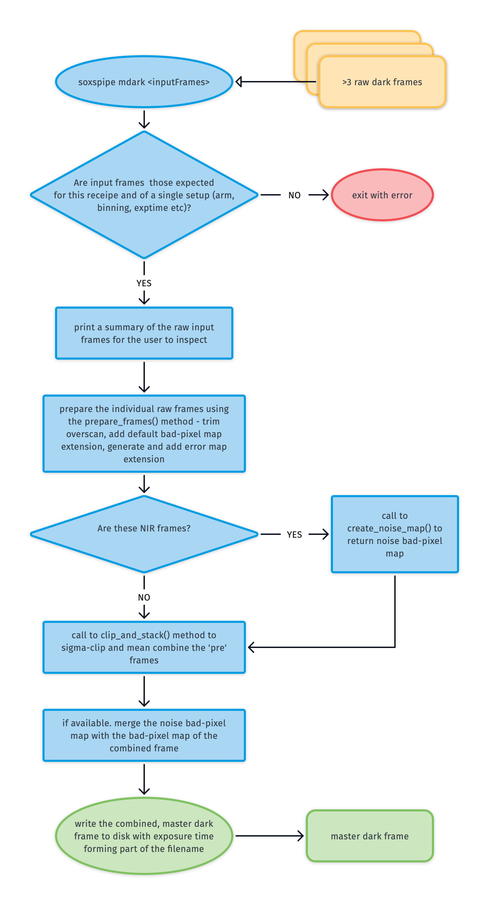

# soxs_mdark

:::{include} ./descriptions/soxs_mdark.inc
:::

## Input

:::{include} ./inputs/soxs_mdark.inc
:::

:::{include} ./static_files/soxs_mdark.inc
:::

## Parameters

:::{include} parameters/soxs_mdark.inc
:::

## Method

The raw dark frames are stacked together (using the [`clip_and_stack`](../utils/clip_and_stack.md) utility) into master-dark frames and, in the process, clipping rogue pixels from the individual raw frames and reducing the read-noise contribution. The algorithm used in the `soxs_mdark` recipe is shown in {numref}`soxs_mdark_diagram`.

:::{figure-md} soxs_mdark_diagram
{width=600px}

The soxs-mdark recipe algorithm.
:::

### Read noise cross-check (NIR)

The `RAW RON` QC of a NIR master dark is a quality-control value only. No later recipe takes its read noise from it. The recipe compares `RAW RON` with the value of the `read-noise-by-ndsamples` table at the `ESO DET NDSAMPLES` of the master dark (see [prepare frames](../utils/prepare_frames.md)). If the two differ by more than 20% of the table value, the recipe writes a warning to the log. The check does not change the QC flag or the product. It does not run if the master dark has no usable `ESO DET NDSAMPLES`, and it does not run for X-Shooter, UVB or VIS.

## Output

:::{include} output/soxs_mdark.inc
:::

## QC Metrics

:::{include} qcs/soxs_mdark.inc
:::

## Recipe API

:::{autodoc2-object} soxspipe.recipes.soxs_mdark.soxs_mdark
:::
