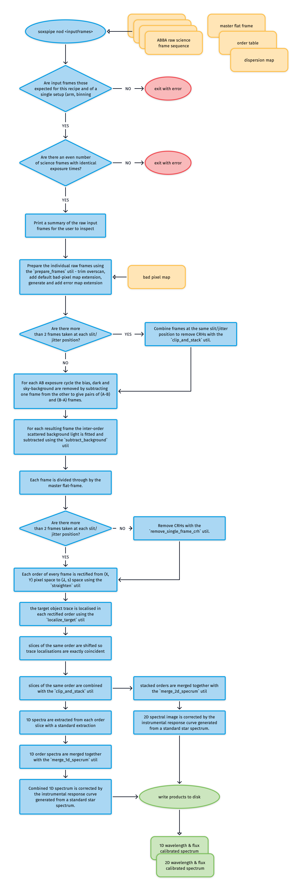
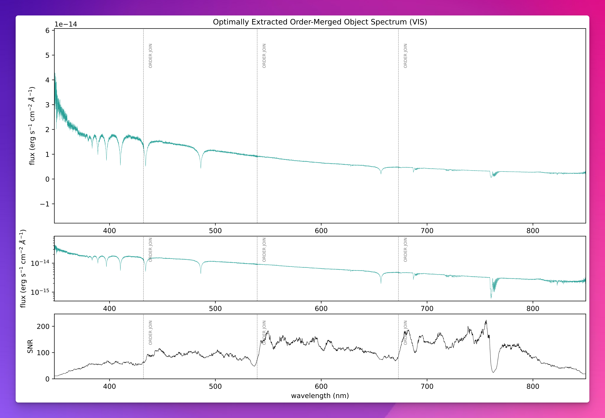
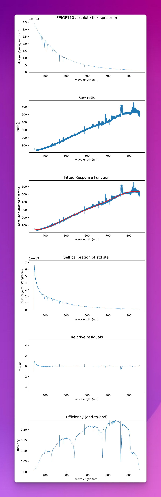

# soxs_nod

:::{include} ./descriptions/soxs_nod.inc
:::


## Input

:::{include} ./inputs/soxs_nod.inc
:::

:::{include} ./static_files/soxs_nod.inc
:::


## Parameters


:::{include} parameters/soxs_nod.inc
:::


## Method

The algorithm used in the `soxs_nod` and `soxs_nod_std` recipe is shown in {numref}`soxs_nod_diagram`.

:::{figure-md} soxs_nod_diagram
{width=600px}

The `soxs_nod` and `soxs_nod_std` recipes reduced SOXS data acquired in nodding mode with one or multiple ABBA sequences, with or without jitter offsets.
:::

During nodding observations, as described in the SOXS Observing Mode sections, 2 locations on the slit, A and B, separated by a few arcseconds, are considered. Observations are performed in pairs of equal-length exposures called cycles. First, a spectrum is taken with the target located at slit-position A. The telescope is then shifted, or 'nodded', so the target is at slit-position B and a second spectrum is taken. This process is then repeated in reverse to acquire the third and fourth exposures at slit-positions B and A, a BA cycle.

Two or more cycles are then combined into a sequence. The shortest sequence possible is AB and BA or ABBA, but sequences can be compiled by many cycles, e.g., an 8-cycle sequence ABBAABBAABBAABBA.

Within this schema, jittering can also be considered. In this case, the target is shifted by a slight random offset each time it is placed at slit positions A and B, avoiding putting the targets always on a bad row or column of the CCD. When including jitter an ABBA sequence becomes A $^{1}$ B $^{1}$ B $^{2}$ A $^{2}$, where the subscript indicates a location at the slit-positions A or B but now including a small random offset (a jitter). The number of different offsets in the data does not change how the recipe works. Only the `stack_before_extraction` setting does.

### Align and stack before extraction (default)

When `stack_before_extraction` is `True` (the default), the recipe proceeds as follows.

1. It detrends the images using bias and flat field, and subtracts the scattered background light if requested.
2. It pairs the A and B frames in time order. For each frame it makes a cycle difference: $A - B$ for an A frame, and $B - A$ for a B frame. It measures the position of the object along the slit on that difference, with the continuum-trace method.
3. It measures each shift against the first frame in time of the same group (the A frames, or the B frames). For SOXS VIS, each order has its own shift, so the u and g orders are measured on their own. For SOXS NIR and for every X-Shooter arm, each frame has one shift, which is the median over the orders.
4. It resamples each frame through the 2D map, so the object lines up along the slit at fixed wavelength. The error and bad-pixel planes are resampled too. A pixel is flagged as bad when its source falls off the order or the detector, or touches a bad pixel.
5. It stacks the aligned A frames, and stacks the aligned B frames. It computes the differences $A - B$ and $B - A$. The pipeline writes both differences to the product directory.
6. It shifts $B - A$ along the slit, so that its positive trace lies on the positive trace of $A - B$. The shift is the slit position of the object in the B stack minus its position in the A stack. These are the positions of step 3 for the first frame in time of each group. The recipe measures them for a group that holds only one frame too. For SOXS VIS, each order has its own shift. For SOXS NIR and every X-Shooter arm, one shift applies to all orders. The recipe then averages the two frames: $(A - B + \text{shifted}(B - A)) / 2$. The variance of the average is a quarter of the sum of the two variances, and a pixel is flagged as bad if it is bad in either frame. The negative traces stay in the frame at half their size. The recipe builds the sky frame the same way: it averages the B frame with the A frame shifted by the same slit shifts.
7. The standard Horne extraction utility extracts the orders of the average frame once. A standard star makes a second extraction on the data that are not flat-fielded, which the response curve needs. The two nod positions are no longer extracted one by one, and the extraction carries the tag of the A sequence.

If an order or a frame has no reliable object trace, it takes the median shift of the others, and the recipe logs a warning that names the frame and the order. The number of such shifts is the `SLIT ALIGN FALLBACK NUM` QC. The recipe also logs each shift and writes a QC plot of the shifts.

If an order has no object position in one of the two groups, its shift is the median of the shifts of the other orders, and the recipe logs a warning that names the orders. The number of such orders is the `NOD COMBINE FALLBACK NUM` QC, which is 0 when the pass was not combined. The two negative traces lie one throw (the distance between the nod positions) from the positive trace. The recipe combines the frames only when the throw of every order is at least as long as the Horne extraction aperture (`horne-extraction-slit-length`). If no order has a position in both groups, or a throw is shorter than the aperture, the recipe logs a warning. The `NOD COMBINED` QC is then 0. The recipe extracts $A - B$ and $B - A$ one by one for each pass, and takes the median of the two spectra.

When you run the recipe with the debug option, it also writes the average frame, before flat-fielding, as `<sof name>_AB_COMBINED_1.fits` and lists it as the `AB_COMBINED` product.

### Extract each cycle (`stack_before_extraction: False`)

When `stack_before_extraction` is `False`, the recipe extracts each AB cycle on its own. It then combines the extracted spectra to make one spectrum. The `save_single_frame_extractions` setting applies to this path.

Standard stars are the exception. The `soxs_nod_std` recipe, and any flux-standard input, always aligns and stacks the frames, even when the setting is `False`. The recipe logs a warning when this happens. This gives one response curve for each standard star SOF.

### Extract each cycle with `--no-stack`

The `--no-stack` option sets `stack_before_extraction` to `False` for one run. It does not change your settings file. It works on `soxspipe reduce all`, `soxspipe reduce sof`, `soxspipe nod` and `soxspipe nod_std`. It has no short form.

- For a science SOF, the recipe extracts each AB cycle on its own, as described above.
- For a standard star SOF, the stacked pass runs first and writes the response curve (`<sof name>_RESP.fits`). If the SOF has two or more cycles, a second pass then extracts each cycle on its own, under the name `<sof name>_CYCLES`, for inspection. This pass makes no response curve and no flux calibration. The recipe logs no warning.
- If any pass fails a QC, the whole SOF fails, and science SOFs do not use its response curve.
- The reducer skips SOFs that it already reduced. Add `-x` (overwrite) to reduce them again.

Note a boxcar extraction is also preformed alongside the Horne extraction. Use the `horne-extraction-slit-length` to control the size of the aperture used to preform the boxcar extraction on the object trace.

### Reduce the frames in stare mode (`--stare`)

Extended emission that is longer than the throw leaves a false feature in the A-B difference (see the host contamination check below). To avoid the subtraction, you can reduce the frames of a nodding SOF with the stare algorithm. Use the `--stare` option of `soxspipe nod` and `soxspipe nod_std` for one run. Set `reduce-as-stare: True` in the `soxs-nod` block (science) or the `soxs-nod-std` block (standard stars) of the settings file for `soxspipe reduce`. The option overrides the setting. The `reduce` command has no `--stare` option. The `soxs_offset` recipe has no stare mode.

```bash
soxspipe nod sof/20251212T045200_VIS_1X1_1_NOD_OBJ_SLIT1_0_1800_0S_SOXS_AT2025aggl.sof --stare
```

In stare mode, the `soxs_stare` recipe reduces the SOF, with these differences from a stare SOF:

1. It reads the frames with the technique `ECHELLE,SLIT,NODDING`.
2. It uses the `soxs-stare` settings, or the `soxs-stare-std` settings for a standard star. The `soxs-nod` settings do not apply, except `reduce-as-stare`. The recipe writes its files to the `soxs-stare` or `soxs-stare-std` directory.
3. It detrends each frame with the master bias (UVB and VIS) or the master dark (NIR), and subtracts the scattered light. It does not flat-field yet.
4. It aligns the A frames to each other and the B frames to each other along the slit, with the same method as the nod mode. It does not shift the B frames onto the A frames. The object is at two slit positions, and a shift of the B frames would leave a part of the slit that only the A frames cover. The sky changes between the A and B exposures, so the sky residual would step at the edge of that part, and the step looks like a second source.
5. It flat-fields each frame, because the flat is fixed on the detector. It then stacks the A frames and the B frames apart, so there are two stacks. A pixel that the alignment flagged as off the slit in a frame does not enter its stack. A pixel that not every frame of a stack covers, after the small alignment shifts, is left out of the sky model and the extraction of that stack and is flagged in the products.
6. It models and subtracts the sky of each stack, and extracts the object with the Horne method from each stack, over the full slit. Each stack has its own sky model.
7. It combines the two extractions as the nod mode combines its cycles: it groups the spectra by wavelength and takes the median. For two spectra the median is the mean. It then flux-calibrates the combined spectrum. For a standard star, it makes the response curve from the combined spectrum. These last steps are those of the [`soxs_stare`](soxs_stare.md) recipe.

If the recipe finds no object trace in one nod position, it logs a warning and uses the extraction of the other position alone. The warning is also on the QC plots. The `EXTRACT METHOD` QC is then `optimal`. If it finds no trace in either position, the recipe stops with an error, as in nod mode. A stack of 2 frames cannot reject cosmic rays: a SOF with 2 A frames and 2 B frames gives two stacks of 2 frames.

The number of A frames and B frames must be the same. If it is not, the recipe stops with an error, as in nod mode. With `--no-stack`, the recipe reduces each frame on its own and does not align frames.

On the NIR arm, a SOF reduced in stare mode needs a master dark (`MASTER_DARK_NIR`). The data organiser adds a matching master dark to the NIR nodding SOFs when one exists (see [the data organiser](../data_organiser_and_reducer/data_organiser.md)). Nod mode ignores the dark: it does not subtract it, because the A-B subtraction already removes the dark, and the NIR read noise does not use the `QC RAW RON` of the dark. In both modes the single-frame read noise comes from the `ESO DET NDSAMPLES` of the raw frames (see [prepare frames](../utils/prepare_frames.md)). Stare mode subtracts the dark and adds the noise of the dark to the sky fit (see [subtract sky](../utils/subtract_sky.md)). A NIR stare-mode run without it stops before the reduction, with an error that says how to add the dark.

The recipe writes the product files with the marker `_STAREMODE` after the SOF name, for example `<sof name>_STAREMODE_SPECTRUM.fits` and `<sof name>_STAREMODE_RESP.fits`. The sky products and the extraction of each nod position carry the position before the marker, for example `<sof name>_A_STAREMODE_SKYSUB.fits` and `<sof name>_B_STAREMODE_SKYSUB.fits`. The products of the combined spectrum have no position. With `--no-stack`, the name of frame N is `<sof name>_F<N>_STAREMODE_...`. The headers of the products have `ESO PRO TECH` set to `ECHELLE,SLIT,STARE` and `ESO PRO STARE MODE` set to `T`. The data organiser does not predict these products. A later SOF does not use them, so a science SOF still uses the response curve of the nod-mode reduction of its standard star. The files of an earlier nod-mode reduction of the SOF stay as they are. The stare-mode run writes the status of the SOF (pass or fail) to the database, so it replaces the status of an earlier nod-mode run of the same SOF.

### Host contamination check

The recipe checks each nod pass for extended emission, for example light from a host galaxy. The check is for information only. It does not change the spectrum and it never makes the recipe fail.

Extended emission that is longer than the throw is not removed by the A-B subtraction. It appears in both nod positions at different places on the slit, and the subtraction leaves a false feature in the spectrum.

The check works on the A-B difference of each pass before flat-fielding, for every order. The flat-field fall-off at the slit edges gives false traces. The check does these steps:

1. It finds the positive trace and the negative trace. They are the slit positions with the most extreme median flux.
2. It subtracts the median of each detector line outside both trace apertures. This removes the sky residual that is flat along the slit and is left when the sky changes between the nods.
3. It sums each trace over an aperture of `horne-extraction-slit-length` pixels for each detector line. The sum is the median of the pixels times their number, so a cosmic ray of 1 or 2 pixels hardly changes it.
4. It models the negative trace as the positive trace times one constant ratio.
5. It counts the narrow features. A feature is a run of at least 2 detector lines where both the residual (the negative trace plus the ratio times the positive trace) and the negative trace itself are above `host-contamination-sigma` times the local noise (default 5).

The local noise is the larger of the propagated error and a running median absolute deviation over 51 detector lines. The check first removes a running median of 51 detector lines. It does not search within 8 detector lines of a catalogue skyline, or in the 25 detector lines at each end of an order. Features within 0.2 nm across orders and cycles count once.

The number of features is the `NOD HOST CONTAM` QC. If the QC is above 0, the recipe logs a warning with the wavelength ranges, and the same warning is printed under the merged-spectrum QC plot. If the check cannot run, the recipe logs a warning and does not write the QC.

The check runs in the `soxs_nod` and `soxs_nod_std` recipes. It does not run in the `soxs_offset` recipe.

**Limitation:** a host that is symmetric about the object leaves no residual at the negative trace. The check does not see this case.

## Output

:::{include} output/soxs_nod.inc
:::

:::{figure-md} soxs_nod_qc_fig


A QC plot resulting from the `soxs_nod` recipe. This is a SOXS VIS wavelength and flux calibrated spectrum of the standard star CD-325613. The top- and middle-panels show the flux and wavelength calibrated spectrum, the top in linear-flux and the middle in log-flux scale. The bottom panel shows the signal-to-noise ratio across the entire wavelength range covered by the spectrum. If optimal extraction logged warnings or errors, they are printed below the plot (ERROR in red, WARNING in orange, at most 20 lines). Each note starts with its nodding position, for example `[A1]`.

:::

:::{figure-md} soxs_nod_response_curve



The output of the `reponse_function` utility (used by nodding and stare recipes) used in the reduction of spectroscopic standard star spectra. The third panel shows th fittted response curve, and the final panel shows the overall efficiency of the instrument across the entire wavelength range of the spectrograph arm.

:::

## QC Metrics


:::{include} qcs/soxs_nod.inc
:::

## Recipe API

:::{autodoc2-object} soxspipe.recipes.soxs_nod.soxs_nod
:::
