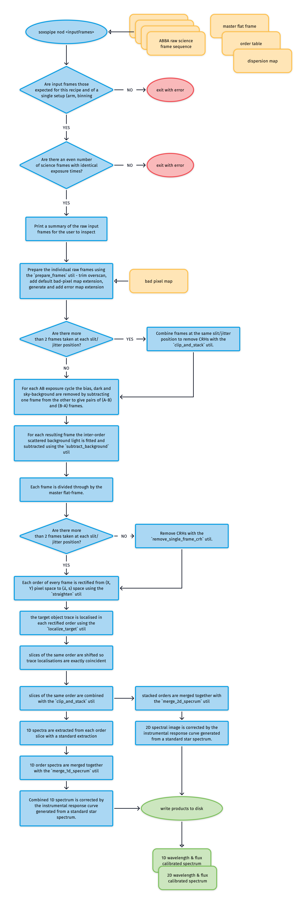
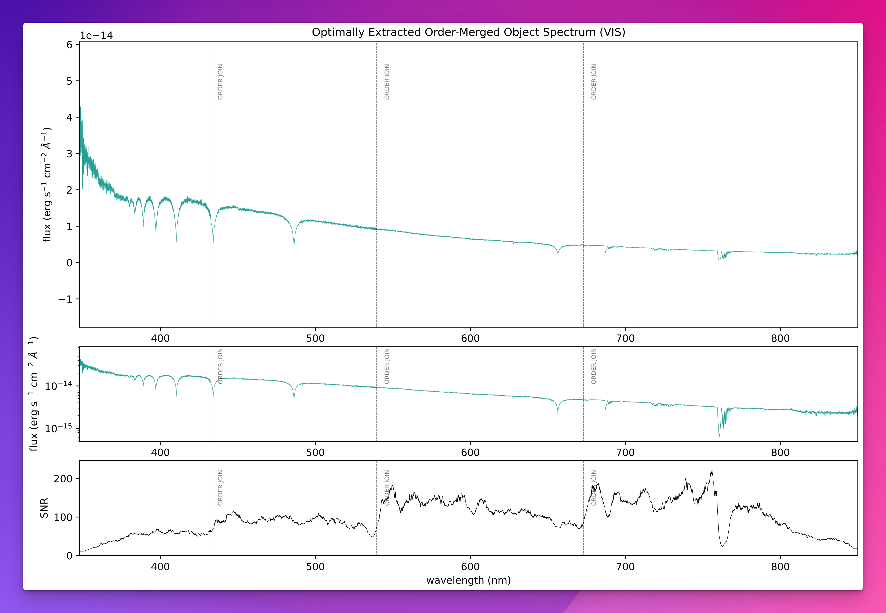

# soxs_nod

:::{include} ./descriptions/soxs_nod.inc
:::

## Input

:::{include} ./inputs/soxs_nod.inc
:::

:::{include} ./static_files/soxs_nod.inc
:::

## Parameters

:::{include} parameters/soxs_nod.inc
:::

## Method

The algorithm used in the `soxs_nod` and `soxs_nod_std` recipe is shown in {numref}`soxs_nod_diagram`.

:::{figure-md} soxs_nod_diagram
{width=600px}

The `soxs_nod` and `soxs_nod_std` recipes reduced SOXS data acquired in nodding mode with one or multiple ABBA sequences, with or without jitter offsets.
:::

During nodding observations, as described in the SOXS Observing Mode sections, 2 locations on the slit, A and B, separated by a few arcseconds, are considered. Observations are performed in pairs of equal-length exposures called cycles. First, a spectrum is taken with the target located at slit-position A. The telescope is then shifted, or 'nodded', so the target is at slit-position B and a second spectrum is taken. This process is then repeated in reverse to acquire the third and fourth exposures at slit-positions B and A, a BA cycle.

Two or more cycles are then combined into a sequence. The shortest sequence possible is AB and BA or ABBA, but sequences can be compiled by many cycles, e.g., an 8-cycle sequence ABBAABBAABBAABBA.

Within this schema, jittering can also be considered. In this case, the target is shifted by a slight random offset each time it is placed at slit positions A and B, avoiding putting the targets always on a bad row or column of the CCD. When including jitter an ABBA sequence becomes A $^{1}$ B $^{1}$ B $^{2}$ A $^{2}$, where the subscript indicates a location at the slit-positions A or B but now including a small random offset (a jitter). The number of different offsets in the data does not change how the recipe works. Only the `stack_before_extraction` setting does.

### Align and stack before extraction (default)

When `stack_before_extraction` is `True` (the default), the recipe proceeds as follows.

1. It detrends the images using bias and flat field, and subtracts the scattered background light if requested.
2. It pairs the A and B frames in time order. For each frame it makes a cycle difference: $A - B$ for an A frame, and $B - A$ for a B frame. It measures the position of the object along the slit on that difference, with the continuum-trace method.
3. It measures each shift against the first frame in time of the same group (the A frames, or the B frames). For SOXS VIS, each order has its own shift, so the u and g orders are measured on their own. For SOXS NIR and for every X-Shooter arm, each frame has one shift, which is the median over the orders.
4. It resamples each frame through the 2D map, so the object lines up along the slit at fixed wavelength. The error and bad-pixel planes are resampled too. A pixel is flagged as bad when its source falls off the order or the detector, or touches a bad pixel.
5. It stacks the aligned A frames, and stacks the aligned B frames. It computes $A - B$ once, and the standard Horne extraction utility extracts the orders once.

If an order or a frame has no reliable object trace, it takes the median shift of the others, and the recipe logs a warning that names the frame and the order. The number of such shifts is the `SLIT ALIGN FALLBACK NUM` QC. The recipe also logs each shift and writes a QC plot of the shifts.

### Extract each cycle (`stack_before_extraction: False`)

When `stack_before_extraction` is `False`, the recipe extracts each AB cycle on its own. It then combines the extracted spectra to make one spectrum. The `save_single_frame_extractions` setting applies to this path.

Standard stars are the exception. The `soxs_nod_std` recipe, and any flux-standard input, always aligns and stacks the frames, even when the setting is `False`. The recipe logs a warning when this happens. This gives one response curve for each standard star SOF.

Note a boxcar extraction is also preformed alongside the Horne extraction. Use the `horne-extraction-slit-length` to control the size of the aperture used to preform the boxcar extraction on the object trace.

## Output

:::{include} output/soxs_nod.inc
:::

:::{figure-md} soxs_nod_qc_fig

A QC plot resulting from the `soxs_nod` recipe. This is a SOXS VIS wavelength and flux calibrated spectrum of the standard star CD-325613. The top- and middle-panels show the flux and wavelength calibrated spectrum, the top in linear-flux and the middle in log-flux scale. The bottom panel shows the signal-to-noise ratio across the entire wavelength range covered by the spectrum. If optimal extraction logged warnings or errors, they are printed below the plot (ERROR in red, WARNING in orange, at most 20 lines). Each note starts with its nodding position, for example `[A1]`.

:::

:::{figure-md} soxs_nod_response_curve

The output of the `reponse_function` utility (used by nodding and stare recipes) used in the reduction of spectroscopic standard star spectra. The third panel shows th fittted response curve, and the final panel shows the overall efficiency of the instrument across the entire wavelength range of the spectrograph arm.

:::

## QC Metrics

:::{include} qcs/soxs_nod.inc
:::

## Recipe API

:::{autodoc2-object} soxspipe.recipes.soxs_nod.soxs_nod
:::
