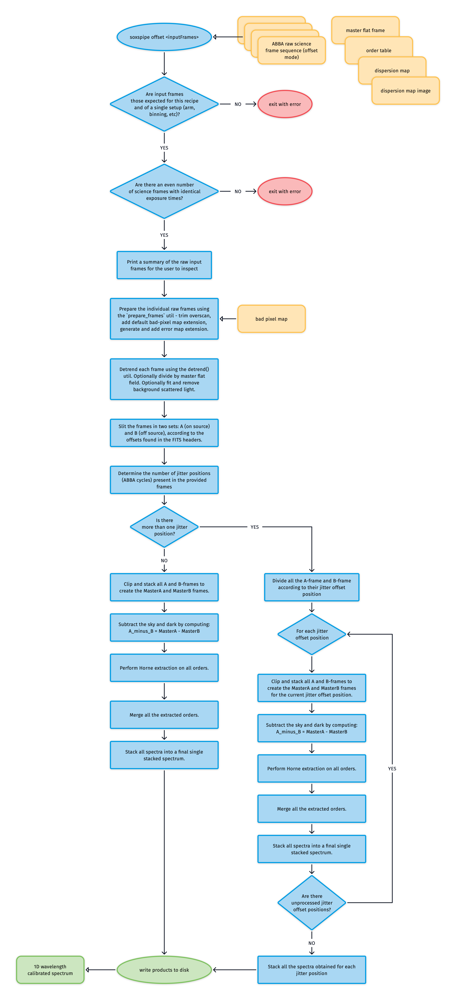

# soxs_offset

:::{include} ./descriptions/soxs_offset.inc
:::

## Input

<!-- FIND OBs HERE : https://docs.google.com/spreadsheets/d/1-3VXkIWcydvpawwVl_C3pNTU3HgnElJaYFAKow65Fl8/edit#gid=0 -->

:::{include} inputs/soxs_offset.inc
:::

## Parameters

:::{include} parameters/soxs_offset.inc
:::

## Method

The `soxs_offset` recipe reduces frames taken with the target on the slit (ON) and off the slit (OFF, the sky). The `stack_before_extraction` setting chooses how it combines them. The number of different offset positions in the data does not choose the path.

### Find the ON and OFF frames

The recipe sorts the frames into ON and OFF frames before it does anything else. It does this for each template run, that is, for each `ESO TPL START` value in the SOF. It compares the pointing (`RA` and `DEC`) of each frame with the pointing of the first exposure of the run (the lowest `ESO TPL EXPNO`).

- **FixedSkyOffset** (`ECHELLE,SLIT,OFFSET`): a frame is ON when it is within `ESO SEQ JITTER WIDTH` plus 1 arcsec of the first exposure. Every other frame is OFF. The recipe also adds up the `ESO SEQ FIXOFF` steps of the run. The pointing of each frame and this sum must agree to within 1 arcsec. The recipe does not use `ESO DPR TYPE` for this template.
- **GenericOffset** (`ECHELLE,SLIT,GENOFFSET`): a frame is OFF when `ESO DPR TYPE` contains `SKY`. A frame is ON when `ESO DPR TYPE` is `OBJECT` and its pointing is within 1 arcsec of the first `OBJECT` frame of the run.

Each run must have the same number of ON and OFF frames. The recipe stops with an error when it cannot classify a frame, when a card it needs is missing, or when a run has no OFF frames. The error names the frame. The recipe does not drop frames, and it does not fall back to `soxs_stare`. Use `soxs_stare` for data that were taken without a sky position.

### Combine the ON and OFF frames

When `stack_before_extraction` is `True` (the default), the recipe pairs each ON frame with an OFF frame of the same template run, in time order. It measures the position of the object along the slit on each cycle difference ($ON - OFF$), with the continuum-trace method, against the first ON frame of the first template run (the one with the lowest `ESO TPL EXPNO`). For SOXS VIS each order has its own shift. For SOXS NIR and every X-Shooter arm each frame has one shift, the median over the orders. An order or frame with no reliable trace takes the median shift of the others, and the `SLIT ALIGN FALLBACK NUM` QC counts these.

The recipe resamples the ON frames through the 2D map so the object lines up along the slit at fixed wavelength, and then stacks them. It stacks the OFF (sky) frames without alignment. It then computes the difference of the two stacks once and extracts it once. It writes a QC plot of the shifts.

When `stack_before_extraction` is `False`, the recipe extracts each ON/OFF cycle on its own and combines the extracted spectra. Standard stars (the `-std` recipes) always align and stack, even when the setting is `False`, with a warning.

### Extract each cycle with `--no-stack`

The `--no-stack` option sets `stack_before_extraction` to `False` for one run. It does not change your settings file. It works on `soxspipe reduce all`, `soxspipe reduce sof` and `soxspipe offset`. It has no short form.

- For a science SOF, the recipe extracts each ON/OFF cycle on its own.
- For a standard star SOF, the stacked pass runs first and writes the response curve. If the SOF has two or more cycles, a second pass then extracts each cycle on its own, under the name `<sof name>_CYCLES`, for inspection. This pass makes no response curve and no flux calibration. The recipe logs no warning.
- If any pass fails a QC, the whole SOF fails, and science SOFs do not use its response curve.
- The reducer skips SOFs that it already reduced. Add `-x` (overwrite) to reduce them again.

:::{figure-md} soxs_offset_diagram
{width=600px}

The `soxs_offset` recipe algorithm.
:::

## Output
 
:::{include} output/soxs_offset.inc
:::

## QC Metrics

:::{include} qcs/soxs_offset.inc
:::

## Recipe API

<!-- :::{autodoc2-object} soxspipe.recipes.soxs_nod.soxs_nod
:::
 -->
