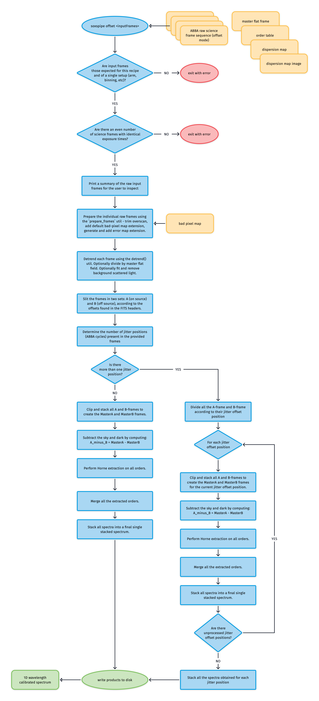

# soxs_offset

:::{include} ./descriptions/soxs_offset.inc
:::

## Input

<!-- FIND OBs HERE : https://docs.google.com/spreadsheets/d/1-3VXkIWcydvpawwVl_C3pNTU3HgnElJaYFAKow65Fl8/edit#gid=0 -->

:::{include} inputs/soxs_offset.inc
:::

## Parameters

:::{include} parameters/soxs_offset.inc
:::

## Method

The `soxs_offset` recipe reduces frames taken with the target on the slit (ON) and off the slit (OFF, the sky). The `stack_before_extraction` setting chooses how it combines them. The number of different offset positions in the data does not choose the path.

When `stack_before_extraction` is `True` (the default), the recipe pairs the ON and OFF frames in time order. It measures the position of the object along the slit on each cycle difference ($ON - OFF$), with the continuum-trace method, against the first ON frame in time. For SOXS VIS each order has its own shift. For SOXS NIR and every X-Shooter arm each frame has one shift, the median over the orders. An order or frame with no reliable trace takes the median shift of the others, and the `SLIT ALIGN FALLBACK NUM` QC counts these.

The recipe resamples the ON frames through the 2D map so the object lines up along the slit at fixed wavelength, and then stacks them. It stacks the OFF (sky) frames without alignment. It then computes the difference of the two stacks once and extracts it once. It writes a QC plot of the shifts.

When `stack_before_extraction` is `False`, the recipe extracts each ON/OFF cycle on its own and combines the extracted spectra. Standard stars (the `-std` recipes) always align and stack, even when the setting is `False`, with a warning.

:::{figure-md} soxs_offset_diagram
{width=600px}

The `soxs_offset` recipe algorithm.
:::

## Output
 
:::{include} output/soxs_offset.inc
:::

## QC Metrics

:::{include} qcs/soxs_offset.inc
:::

## Recipe API

<!-- :::{autodoc2-object} soxspipe.recipes.soxs_nod.soxs_nod
:::
 -->
