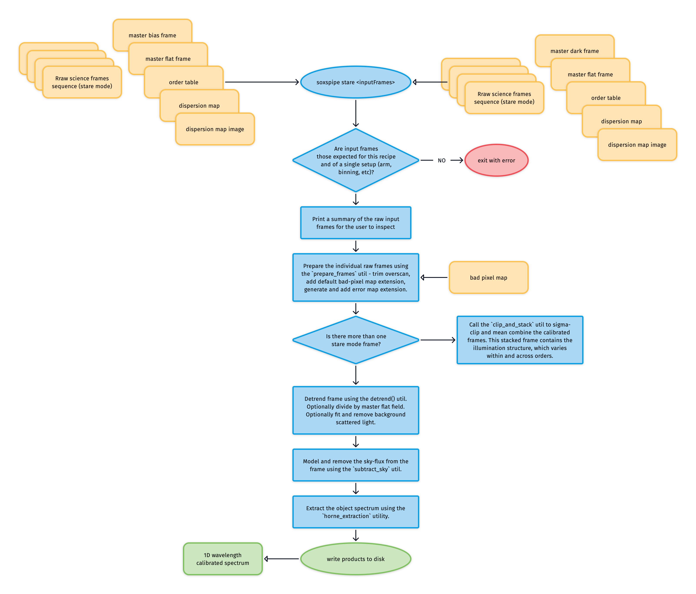
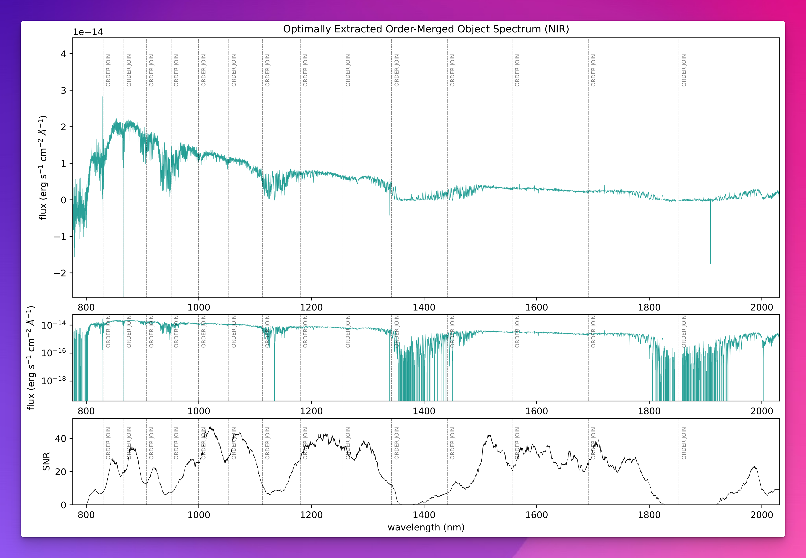

# soxs_stare

:::{include} ./descriptions/soxs_stare.inc
:::

## Input

:::{include} ./inputs/soxs_stare.inc
:::

:::{include} ./static_files/soxs_stare.inc
:::

## Parameters

:::{include} parameters/soxs_stare.inc
:::

## Method

The algorithm used in the `soxs_stare` and `soxs_stare_std` recipes is shown in {numref}`soxs_stare_diagram`.

:::{figure-md} soxs_stare_diagram
{width=600px}

The `soxs_stare`/`soxs_stare_std` recipe algorithm. At the top of the diagram, NIR input data is found on the right and VIS on the left. 
:::

A stare SOF holds all the frames of one observation block (OB) and arm that share the same slit, binning, readout speed and exposure time. The `stack_before_extraction` setting (default `True`) controls how the recipe treats them.

- When `stack_before_extraction` is `True` and the SOF has more than one object frame, a call to [`clip_and_stack`](../utils/clip_and_stack.md) combines the frames into a single frame. The stack is a sigma-clipped mean, so its counts are on the same scale as one frame. It carries the header of the first frame (the exposure time of one exposure, and the airmass and `DATE-OBS` of the first frame). Flux calibration does not use that airmass: it uses the mean airmass of all the stacked frames (see [`flux_calibration`](../utils/flux_calibration.md)). The product header lists every raw frame of the SOF.

  The stacked frame is detrended using the [`detrend`](../utils/detrend.md), optionally dividing by a master flat field and fitting and removing the background scattered light. The sky-flux is modelled and removed using the `subtract_sky` util, and finally, the object is optimally extracted once using the [`horne_extraction`](../utils/horne_extraction.md) utility. The recipe does not align or trace the frames before it stacks them, because the object stays at one slit position.
- When `stack_before_extraction` is `False`, the recipe runs the steps above on each object frame on its own. The products and QC rows of frame N are named `<sof name>_F<N>` (for example `..._F1` and `..._F2`), and the header of each product lists only its own raw frame. If any frame fails a QC, the recipe marks the whole SOF as failed. Only stare frames are extracted one by one: flux standards, and the PAE flat-lamp and nodding-standard fallbacks, are always stacked.
- Flux-standard frames (`STD,FLUX`) are always stacked, even when the setting is `False`. The recipe logs a warning, because the reducer expects one response curve for each SOF.

Before the sky is modelled, SOXS stare frames get a slit-illumination check. Spatial flexure can shift the sky image along the slit, relative to the master flat and the 2D dispersion map, by an amount that differs from order to order. For each order, the recipe measures this offset from the skylines (`measure_slit_illumination`), finds the slit range that is lit in both the sky image and the master flat, and leaves the pixels outside that range out of the sky model. The offsets are written as `SLIT ILLUM OFFSET O<N>` QCs, with a QC plot, but they have no acceptable range, so flexure never fails the recipe. The step runs only if `slit-illumination: measure-offset` is `True` (the SOXS default; X-Shooter and a missing `slit-illumination` block leave it off). The offset follows the rotator angle, so the recipe logs `ABSROT` and warns if the input frames differ in `ABSROT` by more than 10 degrees. The SOXS VIS u and g orders have no skylines below 557.7 nm, so their offset cannot be measured and they are not masked.

Note a boxcar extraction is also preformed alongside the Horne extraction. Use the `horne-extraction-slit-length` to control the size of the aperture used to preform the boxcar extraction on the object trace.

## Output

:::{include} output/soxs_stare.inc
:::

## QC Metrics

:::{include} qcs/soxs_stare.inc
:::

:::{figure-md} soxs_stare_qc_fig

A QC plot resulting from the `soxs_stare` recipe. This is a SOXS NIR wavelength and flux calibrated spectrum of the standard star CD-325613. The top- and middle-panels show the flux and wavelength calibrated spectrum, the top in linear-flux and the middle in log-flux scale. The bottom panel shows the signal-to-noise ratio across the entire wavelength range covered by the spectrum. If optimal extraction logged warnings or errors, they are printed below the plot (ERROR in red, WARNING in orange, at most 20 lines).

:::

## Recipe API

:::{autodoc2-object} soxspipe.recipes.soxs_stare.soxs_stare
:::
