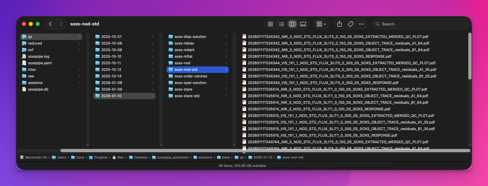
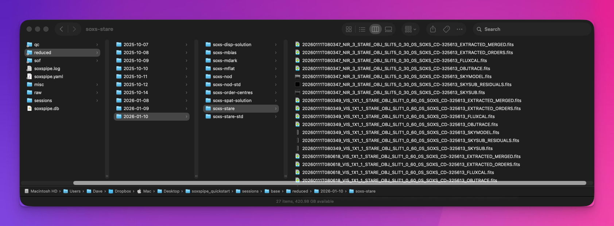
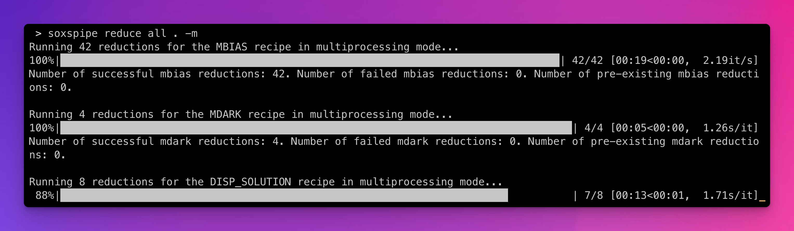

# Reducing Data with a Single Command

In most use cases, you will want to reduce all raw frames within your workspace with a single command. This allows you to run the pipeline at a high level without worrying about individual recipe commands.

To do this, from the root directory of your workspace, run:

```bash
soxspipe reduce all .
```

Once running, the reduce command will execute the pipeline recipes (in order) and generate new data products. During execution, the pipeline writes useful logs to the terminal, providing a status of data-reduction progress. These logs are also written to [individual recipe log files](../logging.md). If, at any stage, a recipe fails to create a data product, the pipeline will attempt to pivot to use the next-best available product. The reduce command stops when all data within the workspace has been reduced.

During runtime, recipes write plots and files to a qc (Quality Control) folder within the workspace. Each recipe writes to its own named directory (see {numref}`qc_folder`).

:::{figure-md} qc_folder
{width=600px}

QC files and plots are written to the workspace `qc` folder.
:::


Each recipe generates products written to the products folder within the workspace, with each recipe writing to its own directory. Recipe log files are also written to the products folder adjacent to their associated products.

:::{figure-md} product_folder

{width=600px}

Recipe products, files and plots are written to the workspace `reduced` folder.
:::

## Extract each frame or cycle on its own

By default, stare, nod and offset SOFs are stacked before extraction (the `stack_before_extraction` setting). To extract each frame or cycle on its own for one run, add the `--no-stack` option:

```bash
soxspipe reduce all . --no-stack
```

The option does not change your settings file. It also works with `soxspipe reduce sof`, and with the `stare`, `stare_std`, `nod`, `nod_std` and `offset` recipe commands. It has no short form.

- Science SOFs: a stare SOF extracts each frame (`<sof>_F<N>`). Nod and offset SOFs extract each cycle.
- Standard star SOFs: the recipe first runs the normal stacked pass, which writes the response curve (`<sof>_RESP.fits`) that later science SOFs read. A stare standard then also extracts each frame as `<sof>_F<N>`, each with its own response curve and QCs. A nod or offset standard then also runs a per-cycle inspection pass under `<sof>_CYCLES`, which makes no response curve and no flux calibration.
- If any pass fails a QC, the whole SOF fails, and science SOFs do not use its response curve.
- `reduce all` skips a SOF that passed in the current session, even if you deleted its product files. A SOF that failed, or only partly reduced, is tried again. Add `-x` (overwrite) to reduce every SOF again.

If you set `stack_before_extraction: False` in the settings file and do not use `--no-stack`, science SOFs are extracted frame by frame or cycle by cycle. Standard stars are still stacked, and the recipe logs a warning.

## Speed up Reductions with Multiprocessing

If you have a large dataset, you can dramatically speed up reductions by using the `--multiprocess` (`-m`) flag. In this mode, the reduce command will reduce recipes in parallel. Instead of seeing each recipe's output logs in the terminal, the user will see a progress bar showing the pipeline's progress as it reduces all the sof files for each recipe.

To do this, from the root directory of your workspace, run:

```bash
soxspipe reduce all . -m
```

By default, the pool for the `mflat`, stare, nod and offset recipes has 3 worker processes, to limit memory use. The pool for every other recipe has one worker process for each CPU. To set the pool size yourself, add the `--cores` (`-c`) option. It sets the number of worker processes for every recipe, and it replaces the default sizes. The value must be a positive whole number no larger than the number of CPUs on your computer, and you can only use it with `-m`. If you use it without `-m`, or give a value outside that range, `soxspipe` prints an error message and exits before it reduces any data. For example, to use 2 worker processes, run:

```bash
soxspipe reduce all . -m --cores 2
```

Choose the value from the memory you have free, not from the number of CPU cores. One NIR stare reduction can use about 13 GB of memory at its peak, so a value that is too high can exhaust the memory of your computer. The progress message for each recipe states the pool size in use.

:::{figure-md} multiprocess


In multiprocessing mode, recipe sof files are reduced in parallel, and the user is presented with a progress bar for each recipe.
:::

## Targetting a Science SOF file for Reduction

In addition to reducing an entire directory of data, `soxspipe` can target specific science SOF files. In this mode of operation, the pipeline will only reduce the calibration data needed to reduce the targeted science SOF file. To list all of the science SOF files in a workspace, run the command:

```bash
soxspipe list sof .
```

Then select an SOF file to target, and run the `reduce` command with the `sof` sub-command, for example:

```bash
soxspipe reduce sof 20260111T080805_VIS_1X1_1_NOD_OBJ_SLIT5_0_60_0S_SOXS_CD-325613.sof
```

As with reducing data with the `all` sub-command, if a recipe fails to create a required calibration product, the pipeline will attempt to pivot to use the next-best available product (as long as other calibration data is available in the workspace).

