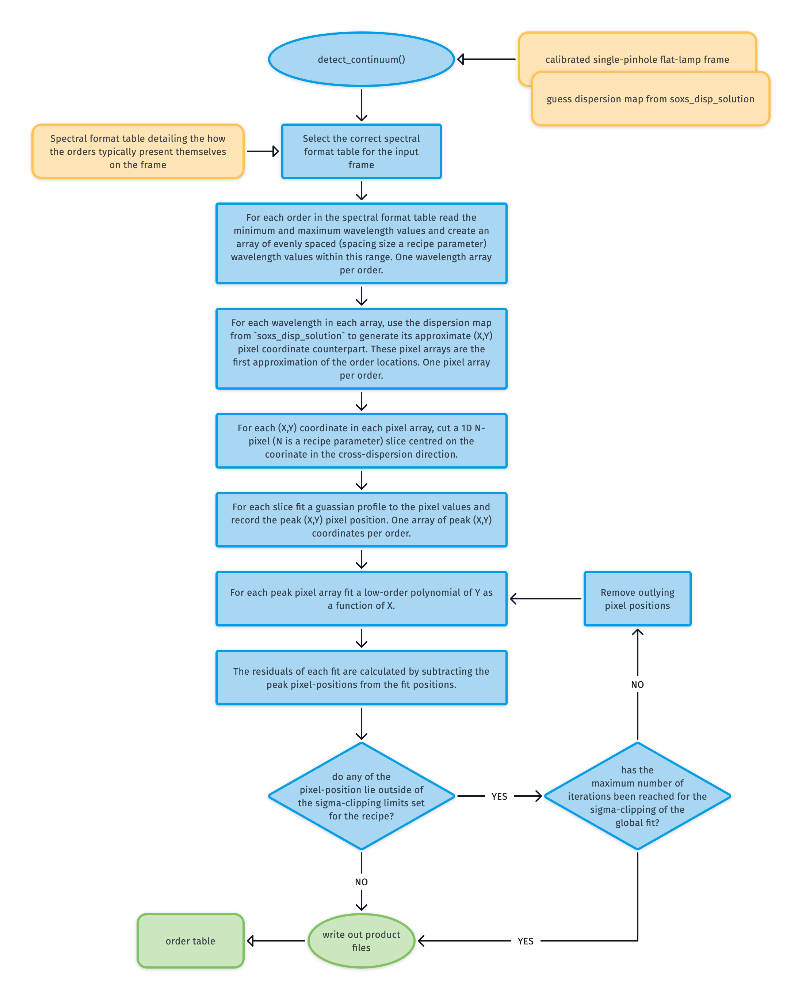
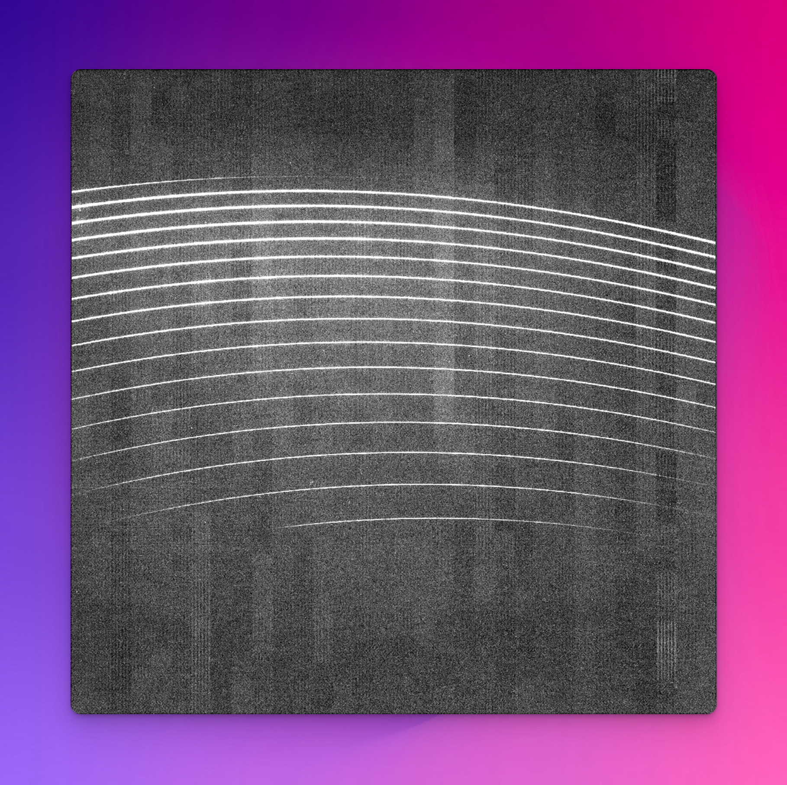
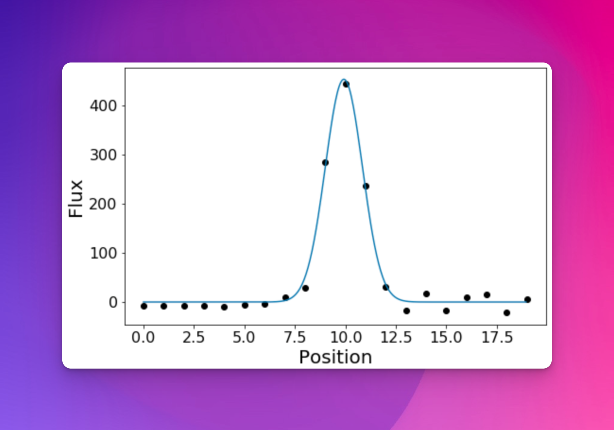
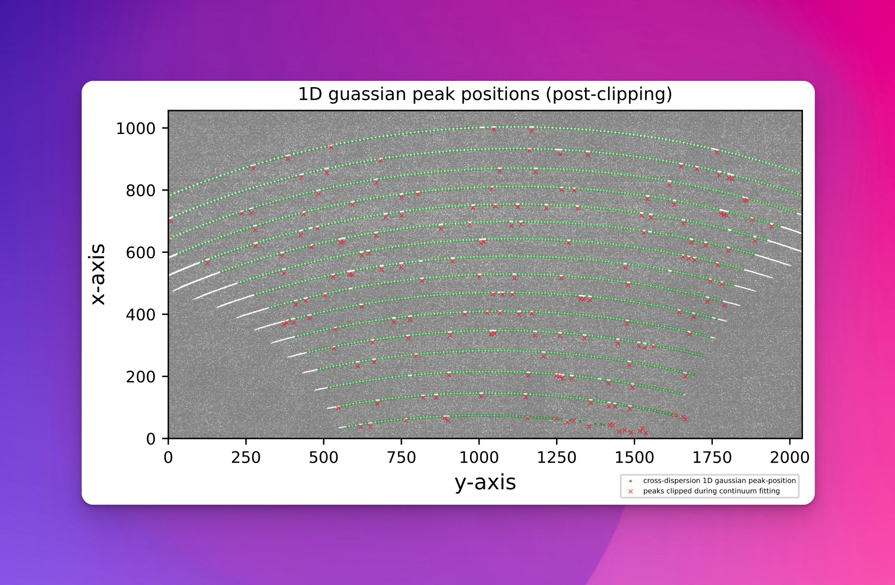
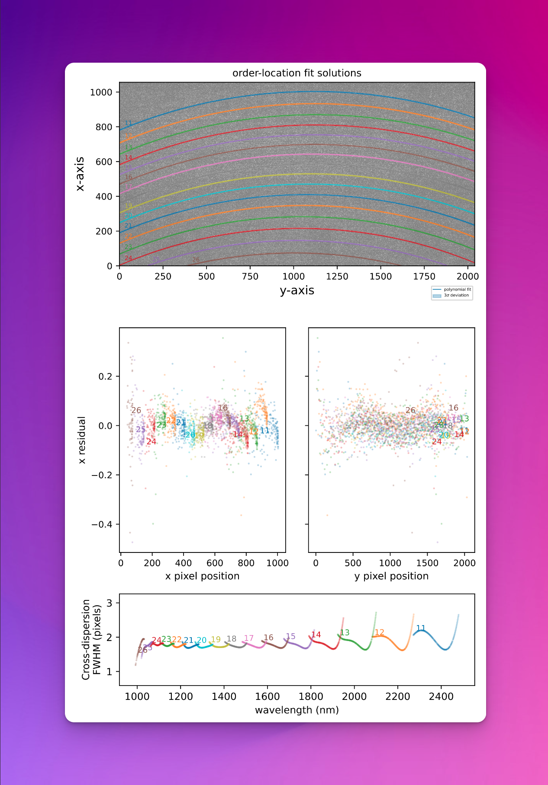

# detect_continuum

The `detect_continuum` utility locates and fits a trace using a low-level polynomial across all echelle orders.

:::{figure-md} detect_continuum_util
{width=600px}

The algorithm used to fit a source trace across all the echelle orders.
:::

The [`detect_continuum`](#soxspipe.commonutils.detect_continuum) utility takes an image frame containing a source trace as input. This trace could be from a calibration lamp (as used in the [`soxs-order-centres`](../recipes/soxs_order_centres.md) recipe, see {numref}`pinhole-flat-image`) or an astrophysical object; the algorithm to fit the trace is the same.

:::{figure-md} pinhole-flat-image
{width=600px}

A 15-second QTH flat-lamp exposure through a pinhole mask onto the SOXS NIR detector.
:::

From a spectral format table (specific to the arm in question), the minimum and maximum wavelength values for each order are known. The first guess dispersion map generated by [`soxs_disp_solution`](../recipes/soxs_disp_solution.md) generates an array of pixel locations along the centre of each order between these wavelength limits.

Centred on each pixel position, an N-pixel long (`slice-length` recipe parameter), M-pixel wide (`slice-width` recipe parameter) image slice is taken in the cross-dispersion direction. Each slice is collapsed to 1 pixel in width by taking the median pixel value at each location along the length of the slice. A 1D gaussian is fitted to the flux in each slice, and if a peak is registered with more than a `peak-sigma-limit` sigma significance, the pixel-position is stored (see {numref}`gaussian-fitting` and {numref}`peak-fits`).

:::{figure-md} gaussian-fitting
{width=600px}

An attempt is made to fit a Gaussian to the flux in each slice. The pixel position is stored if a peak is registered with more than a `peak-sigma-limit` sigma significance.
:::

:::{figure-md} peak-fits
{width=600px}

The green circles represent the location on the cross-dispersion slice where a flux peak was detected. The red crosses show the centre of the slices where a peak failed to be detected.
:::

Finally, the entire set of Gaussian peak pixel positions is iteratively fitted with a polynomial:

$$
X = \sum\limits_{ij} c_{ij} \times n^i \times Y^j
$$

where $X$ and $Y$ are the pixel positions and $n$ is the echelle order number. $i$ and $j$ are the polynomial degree orders for the echelle order (`order-deg`) and $Y$ pixel position (`disp-axis-deg`) respectively. $c_{ij}$ are the polynomial coefficients to be fitted. The polynomial is iteratively fitted while sigma-clipping pixel-positions with outlying residuals. As this is a global fit to the source trace across all orders, even if the source is very faint in a few orders, it still has a good chance of fitting a trace. The final results are stored in an order location table.

:::{figure-md} trace_fit_image
{width=600px}

The top panel show the global polynomial fitted to the detected source trace with the different colours representing individual echelle orders. The middle panels show the fit residuals in the X and Y axes. The bottom panel shows the FWHM of the trace fits (in pixels) with respect to echelle order and wavelength.
:::

### Faint orders in SOXS VIS science frames

This section is for anyone who reduces SOXS VIS science frames with `soxs_stare`, `soxs_nod` or `soxs_offset` and sees a faint order in the QC plots. In a faint order the Gaussian fits to single slices mostly fit noise, so the polynomial trace can drift away from the source. For these orders `detect_continuum` can replace the noisy samples with a trace that follows the neighbouring order, and then fit the global polynomial as usual.

#### Where it applies

The transfer runs only when all of these are true:

- the instrument is SOXS and the arm is VIS;
- the recipe is `soxs_stare`, `soxs_nod` or `soxs_offset`;
- `faint-order-trace` is `True` in the `detect-continuum` block of the recipe settings.

It does not run in the `-std` recipes (`soxs_stare_std`, `soxs_nod_std`, `soxs_offset_std`), in `soxs_order_centres`, or for the NIR and X-Shooter arms. In the shipped settings, `faint-order-trace` is `True` in the VIS blocks of the three science recipes. The code default is `False`, so a settings file without the key does not change.

#### When an order counts as faint

An order is faint when any of these is true:

- the continuum was detected in fewer than `faint-order-min-detection-fraction` of its samples (default 0.5);
- the scatter of its accepted samples about a smooth curve is more than `faint-order-max-scatter-px` (default 1.5 pixels). The scatter is the MAD-based standard deviation of the centre shift about a clipped degree-2 curve through wavelength;
- fewer than four samples were accepted, so the scatter cannot be measured.

#### How the anchor order is chosen

The four VIS orders form two band groups: u and g (orders 2 and 3), and r and i (orders 1 and 4). A faint order takes its anchor from the other order of its own group only. u is never anchored on r or i, and r is never anchored on u or g.

- If only one order of the group is faint, the other order is the anchor.
- If both orders of the group are faint, one of them can still be the anchor. An order can be the anchor when it was detected in at least `faint-order-min-detection-fraction` of its samples and its scatter is at most `faint-order-max-anchor-scatter-px` (default 3.0 pixels). If both can, the one with the lower scatter is the anchor. The anchor keeps its own samples and is not transferred.
- If neither faint order can be the anchor, the group gets no transfer.

The anchor gives the slit position and the width of the source at the edge that the two orders share. For a bright anchor, the slit position comes from a clipped curve through its samples. For an anchor that is faint itself, that curve is not reliable, so the slit position comes from one profile. The profile collapses the anchor's rows within three bin widths of the shared edge, and a fixed-width Gaussian is fitted to it. If this fit fails, the curve is used and the log says so. In `soxs_stare`, the measured slit-illumination offsets of the two orders are applied to the slit position when both orders have one. `soxs_nod` and `soxs_offset` do not apply them.

#### The binned refit

1. The faint order is split into `faint-order-bin-count` wavelength bins (default 15) that hold equal numbers of samples.
2. In each bin, the image rows are collapsed along the anchor track into one cross-dispersion profile.
3. A Gaussian with the anchor's width is fitted inside a window around the anchor. The window is three times the width on each side, but never less than 1.5 arcsec and never more than 1.8 arcsec. This window cannot reach a source 3.7 arcsec away.
4. A bin is kept only if its peak signal-to-noise ratio is at least `faint-order-min-bin-snr` (default 3.0).
5. A curve through the kept bins gives the offset of the trace from the anchor track. The degree is 0 for 1 to 3 kept bins, 1 for 4 to 6, and 2 for 7 or more.
6. Each sampled row of the faint order is replaced with an exact sample of this trace, at the same wavelength. The replaced rows are marked in the trace plot as "trace transferred from" the anchor order. They count towards the global polynomial fit, but they do not set the clipping limit, they are never clipped, and they are left out of the fit-residual statistics.

If an order keeps no bin, nothing was measured that could be transferred. Its rows stay as they were sampled, it is not counted in `N ORDERS FAINT TRACE`, and the log reports "no bin kept, trace left as measured".

#### Settings

Set these in the `detect-continuum` block of the VIS section of the recipe settings.

| Setting | Default | Meaning |
| --- | --- | --- |
| `faint-order-trace` | `False` in code, `True` in the shipped VIS blocks of `soxs_stare`, `soxs_nod` and `soxs_offset` | Switch the transfer on or off. |
| `faint-order-min-detection-fraction` | 0.5 | An order is faint when fewer than this fraction of its samples are detected. A number above 0 and at most 1. |
| `faint-order-max-scatter-px` | 1.5 | An order is faint when the scatter of its centre shift exceeds this (pixels). |
| `faint-order-max-anchor-scatter-px` | 3.0 | The largest scatter at which a faint order can still anchor its faint neighbour (pixels). |
| `faint-order-bin-count` | 15 | Number of wavelength bins. A whole number above 0. |
| `faint-order-min-bin-snr` | 3.0 | The lowest peak signal-to-noise ratio for a kept bin. |
| `same-source-max-join-arcsec` | 2.0 | The same-source warning limit (arcsec). |

A key that is missing or empty takes its default. A value of the wrong type, or a number that is zero, negative or not finite, stops the recipe with an error that names the key.

#### What you see in the outputs

- **QC.** `N ORDERS FAINT TRACE` is the number of orders whose trace was transferred. It is written to the header only when it is above 0, so a frame with no transfer keeps the same header as before. When a transfer happened, the comment of `N ORDERS` adds "a transferred faint order included", because `N ORDERS` counts a transferred order.
- **Log and extraction note.** One line is printed for each faint order that has an anchor, for example "Order 2 (u) trace transferred from 3 (g): 9/15 bins, deg 1". The line also says when the anchor came from the edge profile, and when an order kept no bin. The same line is kept as a note for the extraction.
- **Same-source warning.** When the faint-order transfer is on, the pipeline checks each join between adjacent VIS orders (u and g, g and r, r and i) after the fit. It converts the fitted trace to a slit position on each side of the join, removes the slit-illumination offsets when both orders have one, and writes a log warning if the two differ by more than `same-source-max-join-arcsec`. The warning means the orders may follow different sources, so check the object trace. The check does not change the fit and does not write a QC.

### Utility API

:::{autodoc2-object} soxspipe.commonutils.detect_continuum.detect_continuum
:::

