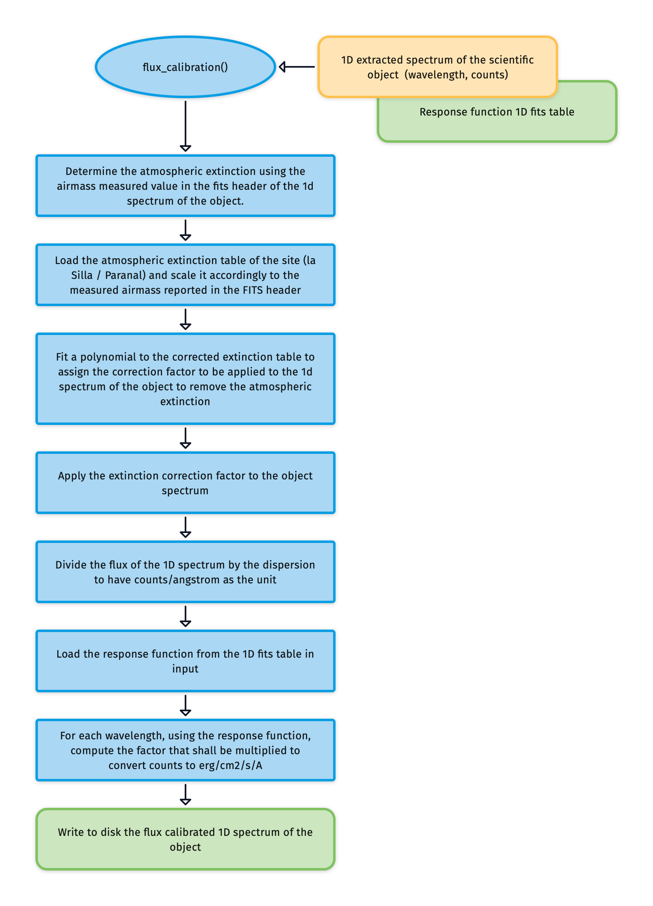

# flux_calibration

The [`flux_calibration`](#soxspipe.commonutils.flux_calibration) utility flux calibrates a scientific spectrum by applying the response function computed by the [`response_function`](#soxspipe.commonutils.response_function) utility.

:::{figure-md} flux_calibration_util
{width=600px}

The algorithm used flux to calibrate a scientific spectrum by applying a response function.
:::

In detail, the airmass is the mean airmass of every raw frame that contributes to the spectrum: all frames of a stare stack, the A and B frames of a nod, and the ON frames of an offset. Each frame contributes the average of `ESO TEL AIRM START` and `ESO TEL AIRM END`, and frames are weighted by their exposure time (`ESO DET SEQ1 EXPTIME` when the frame has it, else `EXPTIME`). A frame that lacks one of the two airmass keywords uses the other, with a warning. The value used is written to the `ESO PRO AIRM MEAN` card of the flux-calibrated product.
Then, the utility loads the extinction curve (a table with wavelength and extinction coefficient $mag_{airmass}$) and rescales it to the airmass calculated before. The extinction curve is then interpolated on a finer grid, which is suitable for application to the extracted scientific spectrum using a nearest neighbour interpolation schema.

The extracted scientific spectrum is then corrected for airmass for each wavelength as follows:

$$
fluxCorrected_{\lambda} = fluxObserved_{\lambda} \times 10^{AM \times mag_{airmass}}
$$

Then, the flat-fielded `FLUX_COUNTS` value for each wavelength is divided by the detector binning along the dispersion axis (`ESO DET BINY` on the VIS arm; the NIR arm is not binned) and by the exposure time reported in the `EXPTIME` keyword. At this stage, the 1D spectrum of the scientific object has units of electrons $s^{-1}$ per unbinned pixel. It is not divided by the dispersion of the spectrograph, because the flat-fielding has already done that. The response product must carry the card `ESO PRO RESP BASIS = PER_UNBINNED_PIXEL` (see [`response_function`](../utils/response_function.md)); a response product without it is refused. To finalize the flux calibration, the utility loads the FITS table that contains the fit parameters for the response function given in input to compute the flux calibrated spectrum for each wavelength, applying the formula

$$
F(\lambda) = \frac{C(\lambda)}{S(\lambda)}
$$

where $F(\lambda)$ is the desired 1D scientific spectrum flux calibrated in $erg$ $cm^{-2}$ $s^{-1}$ ${A^{-1}}$, $C(\lambda)$ is the scientific spectrum in counts and $S(\lambda)$ is the response function.

<!-- ### Utility API

:::{autodoc2-object} soxspipe.commonutils.flux_calibration.flux_calibration
:::
 -->
