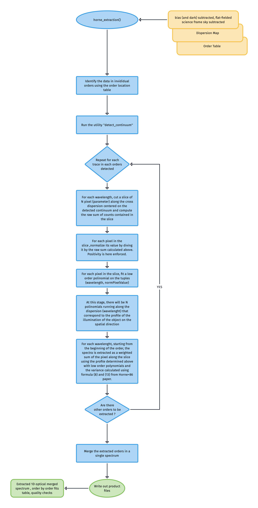

# horne_extraction

The [`horne_extraction`](#soxspipe.commonutils.horne_extraction) utility performs an optimal extraction of a source's flux from an echelle order using the algorithms reported in {cite:t}`horne1986`.

:::{figure-md} horne_extraction_util
{width=600px}

The algorithm used to optimally extract an object spectrum.
:::

This utility, according to the prescription of {cite:t}`horne1986`, follows those basic steps:

### 1 Determination of the spatial profile

Starting from the order_table computed by the `detect_continumm` utility, the horne_extraction utility runs along the spectral direction and takes, for each wavelength centred in the position measured by the detect_continuum utility, a window of 1x`horne-extraction-slit-length`. Then, the pixels are summed, and each pixel in the slice is normalized as 

$$
pixel_i = \frac{Flux_{pixel_i}}{\sum_{j=0}^{N}{Flux_{pixel_j}}}
$$

where N = `horne-extraction-slit-length`.

The flux is normalised for each cross-dispersion slice to detect the object's profile. Then, multiple parallel polynomials are fitted, and outliers are removed using an iterative fitting procedure. Bad pixels are masked. The final flux for each cross-dispersion slide is a weighted sum, as reported in Horne, with the bad pixels and outliers accounted for.

Then, a low-order polynomial is fitted for each pixel in the slice (multiple parallel polynomials), modelling the value of the fractional flux received along the dispersion axis. During the iterative fitting procedure, bad pixels are masked and outliers (CRHs etc) are removed. The complete set of polynomials represents the object's profile along the spatial direction for each wavelength. For a slice length of N pixels, there will be N different polynomials, one per pixel.

Polynomials are fitted with subsequent iterations. Pixels for which residuals deviate more than the `horne-extraction-profile-clipping-sigma` standard deviation are removed before attempting a new fitting of the data. The procedure is repeated for a maximum of `horne-extraction-profile-clipping-iteration-count` times.

When the procedure above is completed, the actual extraction occurs as follows:

### 2 Extraction of the spectrum for each wavelength for each order.

Using the polynomials computed above, the extracted integrated flux for each wavelength in the order is calculated as follows:

$$
extractedFlux_{\lambda} = \frac{\sum_{i = 0}^{N}{P_{i}^{\lambda} (D_{i}^{\lambda} - S_{i}^{\lambda})}}{\sum_{i = 0}^{N}{(P_{i}^{\lambda})^2 (V_{i}^{\lambda})^{-1}}}
$$

Where $P_{i}^{\lambda}$ is the value of the polynomial for the pixel $i^{th}$ evaluated at wavelength $\lambda$, $D_{i}^{\lambda}$ is the raw pixel value on the 2D image, detrended and sky subtracted, of the science object and $S_{i}^{\lambda}$ is the estimated value, at the same pixel position, of the 2D image of the sky model computed in stare mode. When this utility is applied to nodding or offset mode images, this value is chosen to be zero. $V_{i}^{\lambda}$ is the so-called variance image and is computed as 

$$
V_{i}^{\lambda} = V_{0} + \frac{P_{i}^{\lambda} f_{\lambda} +  S_{i}^{\lambda}}{Q}
$$

Where $V_{0}$ is the square of the readout noise of the detector, $f_{\lambda}$ is the sum of the pixels within the extraction window at each wavelength, and $Q$ is the detector gain. 

Cosmic rays and uncorrected deviant pixels are removed from the extraction by comparing their value with a certain threshold. In particular, for each pixel $i$ in the extraction window the quantity

$$
\frac{(D_{i}^{\lambda} - P_{i}{\lambda} f_{\lambda} - S_{i}{\lambda})^2}{V_{i}^{\lambda}}
$$

is computed. The extraction does not include pixels for which this quantity exceeds the `horne-extraction-profile-global-clipping-sigma`. 

The final flux for each cross-dispersion slice is a weighted sum, as reported in {cite:t}`horne1986`, with the bad pixels and outliers accounted for. Note, if more than 3 bad/outlying pixels are found within a cross-dispersion slice, then the slice is ignored.

### 3 Tuning the wavelength solution to the sky lines

The dispersion map is made from daytime calibration frames. At night, flexure moves the spectra on the detector by a small amount. After extraction, the utility corrects for this order by order. It matches the sky lines in each extracted order to the catalogue of sky lines, measures the offset of every matched line, clips the outliers, and adds the median offset to the wavelength solution of the order. Each order gets a `SKY SHIFT O<N>` QC (in nm) and a `SKY SHIFT O<N> PX` QC (the same shift in detector pixels along the dispersion axis).

#### VIS r and i orders: sky-line signal-to-noise gate

On a faint sky, the sky lines of a SOXS VIS order are too weak to centre, and the median shift of the matched lines is then a noise value. For each order that the utility measures from its own sky lines (the SOXS VIS r and i orders), it first computes the signal-to-noise ratio (SNR) of every catalogue calibration line in the `skyFlux` column, at the position the arc solution gives for the line:

$$
\mathrm{SNR}_{line} = \frac{\max(F_{\pm 4}) - \mathrm{median}(F_{\pm 25})}{\sqrt{\mathrm{median}(F_{\pm 25}) + \sigma_{RON}^{2}}}
$$

$F_{\pm 4}$ is the sky flux within 4 samples of the line position, and $F_{\pm 25}$ is the sky flux within 25 samples. $\sigma_{RON}$ is the read noise of the detector. The SNR values of the lines add in quadrature to give the combined SNR of the order.

If the combined SNR is below `MIN_SKY_LINE_SNR` (5.4), the utility does not apply the shift of the order. The log has an info line like "order 4: sky-line SNR 4.7 (min 5.4); no shift applied". The same check decides whether the i shift can drive the r prediction, and whether the r and i shifts can drive the u and g model. Every SOXS VIS order measured from its own sky lines gets a `SKY LINE SNR O<N>` QC.

If i fails the check, the utility measures r on its own. It applies that r shift only if the second-brightest catalogue line of the r order has an SNR of at least `MIN_R_SECOND_LINE_SNR` (2.5). The 557.7 nm line alone can carry the combined SNR of r above the limit, so two kept lines can be one real line and one noise peak. If the second line is too faint, r gets no shift, `R SHIFT SOURCE` is `none`, and its comment has the reason, for example "order 1: 2nd sky line SNR 1.8 (min 2.5)". If r is combined with the i prediction and its own combined SNR is below the limit, r uses the prediction alone, and `R SHIFT SOURCE` is `predicted`.

This gate replaces an earlier limit on the scatter of the kept line shifts (1.5 px). The kept residuals lie in a window of 0.1 nm (2.1 px) either side of zero, so noise alone has a standard deviation of about 1.2 px, and that limit could never fire.

On 25 VIS stare standards from 2026 June and July, only the frame 20260626T044348 changes. Its i and r orders get no shift, and the u and g orders stay unshifted. Its telluric residuals go from -0.56 and -0.62 Å (r and i) to +0.04 Å. The other 24 frames are unchanged. NIR and X-Shooter output is unchanged.

#### VIS u and g orders

The SOXS VIS u (order 2) and g (order 3) orders have no usable sky lines, so they cannot be measured in this way. The utility predicts their shift from the measured shifts of the r (order 1) and i (order 4) orders and from the change in the angle of the derotator (the `ESO ADA ABSROT` keyword) between the science frame and the calibration frame:

$$
\Delta y_{o} = m_{o}\,\frac{\Delta y_{r} + \Delta y_{i}}{2} + c_{o}\,(\cos\theta_{sci} - \cos\theta_{cal}) + s_{o}\,(\sin\theta_{sci} - \sin\theta_{cal})
$$

where $\Delta y_{o}$ is the shift of order $o$ (u or g) in detector pixels along the dispersion axis, science minus calibration. A positive value means the features moved to larger pixel numbers. $\Delta y_{r}$ and $\Delta y_{i}$ are the measured r and i shifts in the same units. $\theta_{sci}$ and $\theta_{cal}$ are the science and calibration `ESO ADA ABSROT` angles. The model converts the predicted pixel shift back to nm with the signed dispersion of the order. The sign comes from the dispersion map: wavelength rises with pixel number in r and i, and falls in u and g.

The coefficients $m_{o}$, $c_{o}$ (`cos`) and $s_{o}$ (`sin`) are in the `ug-wavelength-transfer` block of the VIS section of `soxs_detector_parameters.yaml`. The block also records where they came from (`fit_date`, `n_arcs`, `n_nights`, `absrot_range_deg` and `source`). They were fitted to 72 VIS multi-pinhole arcs taken on 18 nights. With one night left out of the fit at a time, the rms error is 0.96 px for u and 1.14 px for g. An arm without this block (every arm except SOXS VIS) gets no u/g model and no `UG SHIFT SOURCE` QC.

The utility reads the calibration angle from the primary header of the dispersion map. A daytime arc has no usable `ESO ADA ABSROT`, so the utility then uses the park angle of the derotator, 0 degrees. An angle of exactly 0 together with `ESO TEL PARANG START` of exactly 0 is a placeholder value. The utility does not use it as a measured angle.

The model is applied only if all of these guards pass:

| Guard | Limit |
| ----- | ----- |
| Sky lines kept after clipping, order 1 (r) | at least 2 |
| Sky lines kept after clipping, order 4 (i) | at least 10 |
| Combined sky-line SNR, orders 1 (r) and 4 (i) | at least 5.4 |
| Science `ESO ADA ABSROT` | present and usable |

The limit for r is 2, not 4, because the pipeline matches only isolated catalogue lines and keeps 2 or 3 r lines on well-attached frames. A shift from a single r line was a 7 px outlier in the real-data check.

If a guard fails, the recipe does not fail. The u and g orders keep their calibration wavelengths with no shift, the log has an info line that starts "u/g orders left unshifted", and `UG SHIFT SOURCE` is `none` with the reason as its comment. If the model is applied, `UG SHIFT SOURCE` is `model`.

On eight well-attached VIS stare frames from 2026 June and July, the model gave an rms error against the shift measured on an attached arc of 1.03 px (u) and 1.11 px (g). With no correction, the rms error was 1.54 px and 1.51 px. The rms of the Balmer line cores in g went from 0.080 nm to 0.068 nm. The output of the `soxs_stare`, `soxs_stare_std`, `soxs_nod`, `soxs_nod_std` and `soxs_offset` recipes for VIS u and g is therefore different from earlier versions.

### 4 Merging of spectral orders

The spectrum is extracted on each order separately. When all orders are extracted, they are merged together in a single spectrum. Since regions of different orders overlap in the wavelength space, they are first rectified on a common, equally spaced wavelength grid in order to merge together. Flux during resampling is conserved. 

### Utility API

:::{autodoc2-object} soxspipe.commonutils.horne_extraction.horne_extraction
:::
