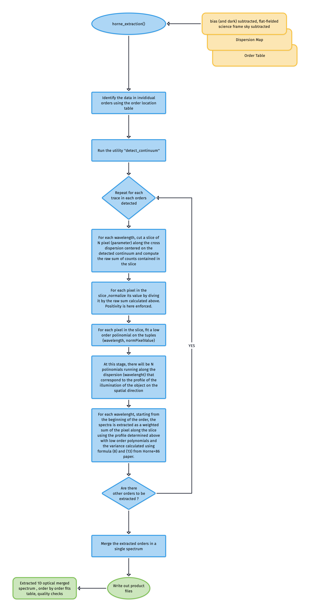

# horne_extraction

The [`horne_extraction`](#soxspipe.commonutils.horne_extraction) utility performs an optimal extraction of a source's flux from an echelle order using the algorithms reported in {cite:t}`horne1986`.

:::{figure-md} horne_extraction_util
{width=600px}

The algorithm used to optimally extract an object spectrum.
:::

This utility, according to the prescription of {cite:t}`horne1986`, follows those basic steps:

### 1 Determination of the spatial profile

Starting from the order_table computed by the `detect_continumm` utility, the horne_extraction utility runs along the spectral direction and takes, for each wavelength centred in the position measured by the detect_continuum utility, a window of 1x`horne-extraction-slit-length`. Then, the pixels are summed, and each pixel in the slice is normalized as 

$$
pixel_i = \frac{Flux_{pixel_i}}{\sum_{j=0}^{N}{Flux_{pixel_j}}}
$$

where N = `horne-extraction-slit-length`.

The flux is normalised for each cross-dispersion slice to detect the object's profile. Then, multiple parallel polynomials are fitted, and outliers are removed using an iterative fitting procedure. Bad pixels are masked. The final flux for each cross-dispersion slide is a weighted sum, as reported in Horne, with the bad pixels and outliers accounted for.

Then, a low-order polynomial is fitted for each pixel in the slice (multiple parallel polynomials), modelling the value of the fractional flux received along the dispersion axis. During the iterative fitting procedure, bad pixels are masked and outliers (CRHs etc) are removed. The complete set of polynomials represents the object's profile along the spatial direction for each wavelength. For a slice length of N pixels, there will be N different polynomials, one per pixel.

Polynomials are fitted with subsequent iterations. Pixels for which residuals deviate more than the `horne-extraction-profile-clipping-sigma` standard deviation are removed before attempting a new fitting of the data. The procedure is repeated for a maximum of `horne-extraction-profile-clipping-iteration-count` times.

When the procedure above is completed, the actual extraction occurs as follows:

### 2 Extraction of the spectrum for each wavelength for each order.

Using the polynomials computed above, the extracted integrated flux for each wavelength in the order is calculated as follows:

$$
extractedFlux_{\lambda} = \frac{\sum_{i = 0}^{N}{P_{i}^{\lambda} (D_{i}^{\lambda} - S_{i}^{\lambda})}}{\sum_{i = 0}^{N}{(P_{i}^{\lambda})^2 (V_{i}^{\lambda})^{-1}}}
$$

Where $P_{i}^{\lambda}$ is the value of the polynomial for the pixel $i^{th}$ evaluated at wavelength $\lambda$, $D_{i}^{\lambda}$ is the raw pixel value on the 2D image, detrended and sky subtracted, of the science object and $S_{i}^{\lambda}$ is the estimated value, at the same pixel position, of the 2D image of the sky model computed in stare mode. When this utility is applied to nodding or offset mode images, this value is chosen to be zero. $V_{i}^{\lambda}$ is the so-called variance image and is computed as 

$$
V_{i}^{\lambda} = V_{0} + \frac{P_{i}^{\lambda} f_{\lambda} +  S_{i}^{\lambda}}{Q}
$$

Where $V_{0}$ is the square of the readout noise of the detector, $f_{\lambda}$ is the sum of the pixels within the extraction window at each wavelength, and $Q$ is the detector gain. 

Cosmic rays and uncorrected deviant pixels are removed from the extraction by comparing their value with a certain threshold. In particular, for each pixel $i$ in the extraction window the quantity

$$
\frac{(D_{i}^{\lambda} - P_{i}^{\lambda} f_{\lambda} - S_{i}^{\lambda})^2}{V_{i}^{\lambda}}
$$

is computed. Here $D - S$ is the sky-subtracted flux, and $V$ is the rectified variance from the error extension, not the model variance above. The profile-fraction check below is applied after this clip.

In each wavelength column, the pixel with the largest value is removed from the optimal flux if the value is more than the square of `horne-extraction-residual-clipping-sigma` (default 5). Then $f_{\lambda}$ is computed again from the remaining pixels, and the step repeats until no pixel passes the limit, for at most 5 passes. The boxcar fluxes keep the removed pixels. If cosmic rays hit most of the profile in one column, for example the two brightest rows of a short slit, the clip cannot tell them from the object and can remove clean pixels instead.

In NIR columns with no object, the stated variance is larger than the scatter of the rectified pixels, so the default limit removes fewer noise pixels than a limit of 5 standard deviations of the real noise. On 10 VIS and NIR stare, nod and offset frames, the clip mostly removes positive spikes in faint orders. In bright columns it also removes pixels where the fitted profile does not match the data, and the order median flux of a bright order changes by 0.7% or less.

The utility does not clip cosmic rays before it fits the profile. Before the fit, it masks only the pixels with a non-finite flux and the pixels flagged in the bad-pixel mask. The residual clip described above rejects the cosmic rays, on any slit length.

The final flux for each cross-dispersion slice is a weighted sum, as reported in {cite:t}`horne1986`, with the bad pixels and outliers accounted for. Note, if more than 3 bad/outlying pixels are found within a cross-dispersion slice, then the slice is ignored.

The weighted sum needs the unmasked pixels of a slice to hold a useful part of the object profile. The profile is normalised so that it sums to 1 over the slit. If the sum of the profile over the unmasked pixels of a slice is less than `horne-extraction-minimum-profile-fraction`, the slice gets no optimal flux and is removed from the extracted orders table. Without this check, a slice whose object pixels are all masked keeps a finite flux of millions of counts with a variance of 10¹² or more, because both sums of the weighted sum are then tiny but not zero.

The default is 0.05, set in each stare, nod and offset recipe block of the settings file. A settings file without the key uses 0.05, and 0 keeps every slice. The value must be at least 0 and less than 1.

On 10 recorded VIS and NIR stare, nod and offset frames, the lowest unmasked profile fraction of an ordinary slice is 0.12 (NIR) and 0.32 (VIS). Every slice below 0.05 has a variance at least 99 times the median variance of the slices around it. The default is therefore 2.4 times below the lowest ordinary NIR slice.

### 3 Tuning the wavelength solution to the sky lines

The dispersion map is made from daytime calibration frames. At night, flexure moves the spectra on the detector by a small amount. After extraction, the utility corrects for this order by order. It matches the sky lines in each extracted order to the catalogue of sky lines, measures the offset of every matched line, clips the outliers, and adds the median offset to the wavelength solution of the order. Each order gets a `SKY SHIFT O<N>` QC (in nm) and a `SKY SHIFT O<N> PX` QC (the same shift in detector pixels along the dispersion axis).

#### Switching the tuning off

Set `tune-wavelength-to-skylines: False` in the recipe block of the settings file (for example `soxs-stare`) to keep the arc wavelength solution as it is. The default is `True`. A settings file without the key tunes. When the tuning is switched off, the utility prints a line in the log, adds a note to the QC plot, and writes the `SKY TUNING` QC as `skipped: switched off`. No `SKY SHIFT` QCs are written. Any value other than `True` or `False` stops the recipe with an error.

#### Attached arc: no tuning

For SOXS, the utility skips this step when the arc is attached to the science exposures. An arc is attached when two conditions are true:

- The time from the end of the earlier exposure to the start of the later one is 7 minutes or less. For an arc taken before the science, this is the time from the end of the arc to the start of the first science frame. For an arc taken after the science, it is the time from the end of the last science frame to the start of the arc. An arc that overlaps the science exposures is 0 minutes away.
- Its rotator angle (`ESO ADA ABSROT END`) differs by less than 5 degrees from the science frame nearest to it in time: the first frame for an arc taken before, and the last frame for an arc taken after.

The science exposures are all the raw science frames of the observation block: one frame for a single stare frame, or every frame of a nod, offset, or stacked stare sequence. Each exposure starts at `MJD-OBS`. It ends `ESO DET SEQ1 EXPTIME` seconds later when the frame has that keyword (NIR, where `EXPTIME` is one DIT and not the whole exposure), and `EXPTIME` seconds later when it does not (VIS). A frame with no usable rotator angle, start time or exposure time is never attached.

The wavelength solution of an attached arc is accurate enough that the tuning only adds noise. The utility prints the arc offsets, adds a note to the QC plot, and writes the `SKY TUNING` QC (`skylines`, or `skipped: attached arc`). No `SKY SHIFT` QCs are written when the step is skipped. X-Shooter is always tuned, unless the tuning is switched off.

#### VIS r and i orders: sky-line signal-to-noise gate

On a faint sky, the sky lines of a SOXS VIS order are too weak to centre, and the median shift of the matched lines is then a noise value. For each order that the utility measures from its own sky lines (the SOXS VIS r and i orders), it first computes the signal-to-noise ratio (SNR) of every catalogue calibration line in the `skyFlux` column, at the position the arc solution gives for the line:

$$
\mathrm{SNR}_{line} = \frac{\max(F_{\pm 4}) - \mathrm{median}(F_{\pm 25})}{\sqrt{\left(\mathrm{median}(F_{\pm 25}) + \sigma_{RON}^{2}\right) / \mathrm{NDIT}}}
$$

$F_{\pm 4}$ is the sky flux within 4 samples of the line position, and $F_{\pm 25}$ is the sky flux within 25 samples. NDIT is the number of integrations that the frame averages (`ESO DET NDIT`, 1 when the card is missing), so the SNR is √NDIT times the SNR of a one-integration frame. $\sigma_{RON}$ is the read noise of one integration that the recipe resolved for the frame. For SOXS NIR it comes from the sample-count table (see [prepare frames](prepare_frames.md)). The SNR values of the lines add in quadrature to give the combined SNR of the order.

If the combined SNR is below `MIN_SKY_LINE_SNR` (5.4), the utility does not apply the shift of the order. The log has an info line like "order 4: sky-line SNR 4.7 (min 5.4); no shift applied". The same check decides whether the i shift can drive the r prediction, and whether the r and i shifts can drive the u and g model. Every SOXS VIS order measured from its own sky lines gets a `SKY LINE SNR O<N>` QC.

If i fails the check, the utility measures r on its own. It applies that r shift only if the second-brightest catalogue line of the r order has an SNR of at least `MIN_R_SECOND_LINE_SNR` (2.5). The 557.7 nm line alone can carry the combined SNR of r above the limit, so two kept lines can be one real line and one noise peak. If the second line is too faint, r gets no shift, `R SHIFT SOURCE` is `none`, and its comment has the reason, for example "order 1: 2nd sky line SNR 1.8 (min 2.5)". If r is combined with the i prediction and its own combined SNR is below the limit, r uses the prediction alone, and `R SHIFT SOURCE` is `predicted`.

This gate replaces an earlier limit on the scatter of the kept line shifts (1.5 px). The kept residuals lie in a window of 0.1 nm (2.1 px) either side of zero, so noise alone has a standard deviation of about 1.2 px, and that limit could never fire.

On 25 VIS stare standards from 2026 June and July, only the frame 20260626T044348 changes. Its i and r orders get no shift, and the u and g orders stay unshifted. Its telluric residuals go from -0.56 and -0.62 Å (r and i) to +0.04 Å. The other 24 frames are unchanged. NIR and X-Shooter output is unchanged.

#### VIS u and g orders

The SOXS VIS u (order 2) and g (order 3) orders have no usable sky lines, so they cannot be measured in this way. The utility predicts their shift from the measured shifts of the r (order 1) and i (order 4) orders and from the change in the angle of the derotator (the `ESO ADA ABSROT` keyword) between the science frame and the calibration frame:

$$
\Delta y_{o} = m_{o}\,\frac{\Delta y_{r} + \Delta y_{i}}{2} + c_{o}\,(\cos\theta_{sci} - \cos\theta_{cal}) + s_{o}\,(\sin\theta_{sci} - \sin\theta_{cal})
$$

where $\Delta y_{o}$ is the shift of order $o$ (u or g) in detector pixels along the dispersion axis, science minus calibration. A positive value means the features moved to larger pixel numbers. $\Delta y_{r}$ and $\Delta y_{i}$ are the measured r and i shifts in the same units. $\theta_{sci}$ and $\theta_{cal}$ are the science and calibration `ESO ADA ABSROT` angles. The model converts the predicted pixel shift back to nm with the signed dispersion of the order. The sign comes from the dispersion map: wavelength rises with pixel number in r and i, and falls in u and g.

The coefficients $m_{o}$, $c_{o}$ (`cos`) and $s_{o}$ (`sin`) are in the `ug-wavelength-transfer` block of the VIS section of `soxs_detector_parameters.yaml`. The block also records where they came from (`fit_date`, `n_arcs`, `n_nights`, `absrot_range_deg` and `source`). They were fitted to 72 VIS multi-pinhole arcs taken on 18 nights. With one night left out of the fit at a time, the rms error is 0.96 px for u and 1.14 px for g. An arm without this block (every arm except SOXS VIS) gets no u/g model and no `UG SHIFT SOURCE` QC.

The utility reads the calibration angle from the primary header of the dispersion map. A daytime arc has no usable `ESO ADA ABSROT`, so the utility then uses the park angle of the derotator, 0 degrees. An angle of exactly 0 together with `ESO TEL PARANG START` of exactly 0 is a placeholder value. The utility does not use it as a measured angle.

The model is applied only if all of these guards pass:

| Guard | Limit |
| ----- | ----- |
| Sky lines kept after clipping, order 1 (r) | at least 2 |
| Sky lines kept after clipping, order 4 (i) | at least 10 |
| Combined sky-line SNR, orders 1 (r) and 4 (i) | at least 5.4 |
| Science `ESO ADA ABSROT` | present and usable |

The limit for r is 2, not 4, because the pipeline matches only isolated catalogue lines and keeps 2 or 3 r lines on well-attached frames. A shift from a single r line was a 7 px outlier in the real-data check.

If a guard fails, the recipe does not fail. The u and g orders keep their calibration wavelengths with no shift, the log has an info line that starts "u/g orders left unshifted", and `UG SHIFT SOURCE` is `none` with the reason as its comment. If the model is applied, `UG SHIFT SOURCE` is `model`.

On eight well-attached VIS stare frames from 2026 June and July, the model gave an rms error against the shift measured on an attached arc of 1.03 px (u) and 1.11 px (g). With no correction, the rms error was 1.54 px and 1.51 px. The rms of the Balmer line cores in g went from 0.080 nm to 0.068 nm. The output of the `soxs_stare`, `soxs_stare_std`, `soxs_nod`, `soxs_nod_std` and `soxs_offset` recipes for VIS u and g is therefore different from earlier versions.

### 4 Merging of spectral orders

The spectrum is extracted on each order separately. When all orders are extracted, they are merged together in a single spectrum. Since regions of different orders overlap in the wavelength space, they are first rectified on a common, equally spaced wavelength grid in order to merge together. Flux during resampling is conserved. 

Before the merge resamples, it drops each pixel whose variance is more than 1 000 000 times the median variance of the 101 pixels around it. A pixel like this has almost no information, but resampling by linear interpolation would still carry its flux into the merged spectrum. The pixel is removed from the flux, variance, and sky columns. The extracted orders table keeps it. The merge writes the number of dropped pixels to the log. Set `merge-variance-clip-factor` in the recipe block of the settings file to change the factor. A settings file without the key uses 1 000 000, and `inf` switches the mask off. The value must be a number above 1. On the recorded VIS and NIR extractions, sky-line pixels reach 560 000 times the local median at most, so they are kept.

### 5 Telluric-line shift of the star (QC only)

After the sky-line tuning, the utility measures how far the telluric absorption lines of the star are from their catalogue wavelengths. It reports the result as QC values. It does not change any wavelength.

The sky fills the slit evenly, so the tuning makes the wavelength scale right for light that enters at the centre of the slit. The telluric lines are carried by the star, so they enter the slit where the star is. The shift of the telluric lines is therefore the centring offset of the star across the slit width, plus any error that the sky-line tuning left. In a narrow slit the centring part is close to 0, so a narrow-slit value measures the tuning error only. In a 5 arcsec slit the star can sit up to about 1 Å from the slit centre.

The utility uses the sky-tuned orders of the flattened extraction, before the orders are merged, before the flux calibration and before any barycentric correction. The not-flattened extraction measures nothing.

The line list is `telluric_lines.fits` in the static calibrations. It holds telluric absorption lines from the HITRAN database (H₂O, O₂ and CO₂), in air wavelengths, for these bands:

| Arm | Bands |
| --- | --- |
| VIS | O₂ B (686 to 697 nm), H₂O (714 to 735 nm), O₂ A (758 to 772 nm), H₂O (920 to 980 nm) |
| NIR | H₂O (1110 to 1160 nm), H₂O (1400 to 1500 nm), H₂O (1750 to 1850 nm), CO₂ (2000 to 2060 nm) |

The VIS arm ends at 850 nm, so the 920 to 980 nm band of the VIS list is never covered and always reads `not measured`. One list serves every slit width. A line is in the list only if it stays isolated at the lowest resolution SOXS uses. To test this, a model of the atmosphere is smoothed to resolving powers of 3500 and 5000, at three water columns, and the fit described below runs on each line of the model. The line is kept if the fitted centre moves by 0.15 Å or less over those models. The wavelength in the list is the mean fitted centre. It is the position that the fit returns on the HITRAN model, and it can differ by a few hundredths of a nm from the HITRAN wavelength of a line that has a close neighbour. The `LINE_NM` column holds the HITRAN wavelength. The script that builds the list is in the pull request of DY-1969.

For each line in an order, the utility fits a Gaussian absorption line on a straight continuum in a window of ±2.5 times the width of a line at a resolving power of 4000. The shift of the line is the fitted centre minus the catalogue wavelength. A fit is rejected when the centre or the width reaches the edge of its allowed range, when the line is shallower than 3 percent, or when the shift is more than 3 Å. When two orders overlap, the fit with the smaller centroid error is used.

A band counts as measured when it has at least 5 lines with a centroid error below 0.3 Å. Any other band is reported as `not measured`. The values are:

- `TELL SHIFT` (nm): the median shift of all lines in the measured bands.
- `TELL SHIFT ERR` (nm): 1.4826 times the median absolute deviation of the line shifts, divided by √N.
- `TELL NLINES`: the number of lines used.

These three QCs go to the header of the products. The QC table also holds `TELL SHIFT <band>`, `TELL SHIFT ERR <band>` and `TELL NLINES <band>` for each band. When no band is measured, `TELL SHIFT` and `TELL SHIFT ERR` read `not measured` and stay out of the header. The values have no acceptable range and never fail a recipe. A QC plot (`TELLURIC_SHIFT_QC_PLOT`) shows the shift of each line against wavelength, coloured by band, with the median marked.

Set `measure-telluric-shift: False` in the recipe block of the settings file to switch the measurement off. The default is `True`. A settings file without the key measures. Any value other than `True` or `False` stops the recipe with an error. An error inside the measurement is logged as a warning and the recipe goes on. X-Shooter has no telluric line list, so it measures nothing.

### Utility API

:::{autodoc2-object} soxspipe.commonutils.horne_extraction.horne_extraction
:::
