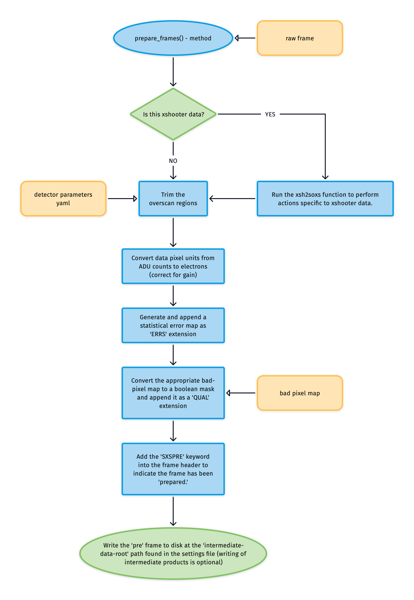

# prepare_frames

The purpose of [`prepare_frames`](#soxspipe.recipes.base_recipe.base_recipe.prepare_frames) is to prepare the raw SOXS frames for data reduction by trimming the overscan regions, converting the data count unit to electrons and assigning an initial error map and bad-pixel maps.

:::{figure-md} prepare_frame_util
{width=600px}

This is the algorithm used to prepare raw frames for data reduction.
:::

**1. Trim Overscan**

The first thing we need to do is trim off the overscan area of the image. The science-pixel regions for the detectors are read from the detector parameters file.

**2. ADU to Electrons**

Next, the pixel data is converted from ADU to electron counts by multiplying each pixel value in the raw frame by the detector gain (the gain is read in units of electrons/ADU).

$$\rm{electron\ count} = \rm{adu\ count} \times \rm{gain}$$

**3. Generating an Uncertainty Map**

Next, an uncertainty map is generated for the raw image and added as the 'ERR' extension of the image.

For each pixel, the uncertainty is the square root of the variance:

$$\rm{error} = \sqrt{\frac{\max(\rm{electron\ count}, 0) + \rm{readnoise}^2}{\rm{NDIT}}}$$

A bias frame has the read noise only, so its error is $\rm{readnoise} / \sqrt{\rm{NDIT}}$.

NDIT is the number of integrations in the file (`ESO DET NDIT`). A raw NIR file is the mean of its NDIT integrations, so its variance is the variance of one integration divided by NDIT. A frame with no NDIT card, such as a VIS or X-Shooter UVB frame, is one integration (NDIT is 1). The same is true for a card that is not a whole number of at least 1, and the recipe writes a warning. The read noise is the value for one integration. Stacking and flux calibration need no NDIT term, because the error of each prepared frame already includes it.

<!-- **Bitmap Extension**

The appropriate bitmap extension is selected and simply added as the 'FLAG' extension of the frame. -->

**4. Bad Pixel Mask**

The default detector bitmap is read from the static calibration suite and converted to a boolean mask, with values >0 becoming TRUE to indicate these pixels must be masked. All other values are set to FALSE. This map is added as the 'QUAL' extension of the image. 

Finally, the prepared frames are saved into an intermediate frames location with the prefix `pre_`.

Viewing the image in DS9 (using the command `ds9 -multiframe -tile columns pre_filename.fits` to show all extensions as tiled frames), we can see the 'FLUX', 'QUAL' and 'ERR' extensions are now all present.

:::{figure-md} image_extensions
{width=600px} 

Each prepared frame has data (FLUX), bad-pixel mask (QUAL) and uncertainty map (ERR) extensions. 
:::

## Recipe API

:::{autodoc2-object} soxspipe.recipes.base_recipe.base_recipe.prepare_frames
:::

