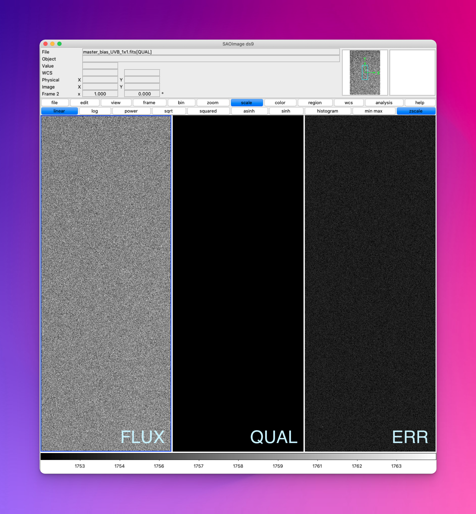

# prepare_frames

The purpose of [`prepare_frames`](#soxspipe.recipes.base_recipe.base_recipe.prepare_frames) is to prepare the raw SOXS frames for data reduction by trimming the overscan regions, converting the data count unit to electrons and assigning an initial error map and bad-pixel maps.

:::{figure-md} prepare_frame_util
{width=600px}

This is the algorithm used to prepare raw frames for data reduction.
:::

**1. Trim Overscan**

The first thing we need to do is trim off the overscan area of the image. The science-pixel regions for the detectors are read from the detector parameters file.

**2. ADU to Electrons**

Next, the pixel data is converted from ADU to electron counts by multiplying each pixel value in the raw frame by the detector gain (the gain is read in units of electrons/ADU).

$$\rm{electron\ count} = \rm{adu\ count} \times \rm{gain}$$

**3. Generating an Uncertainty Map**

Next, an uncertainty map is generated for the raw image and added as the 'ERR' extension of the image.

For each pixel, the uncertainty is the square root of the variance:

$$\rm{error} = \sqrt{\frac{\max(\rm{electron\ count}, 0) + \rm{readnoise}^2}{\rm{NDIT}}}$$

A bias frame has the read noise only, so its error is $\rm{readnoise} / \sqrt{\rm{NDIT}}$.

NDIT is the number of integrations in the file (`ESO DET NDIT`). A raw NIR file is the mean of its NDIT integrations, so its variance is the variance of one integration divided by NDIT. A frame with no NDIT card, such as a VIS or X-Shooter UVB frame, is one integration (NDIT is 1). The same is true for a card that is not a whole number from 1 to 10000, and the recipe writes a warning. X-Shooter NIR frames carry the same card, so those with an NDIT above 1 change in the same way. The read noise is the value for one integration. Stacking and flux calibration need no NDIT term, because the error of each prepared frame already includes it. The sky-fit weights of the stare sky subtraction and the sky-line SNR gate of the skyline tuning divide the noise model by NDIT in the same way.

**Read noise of SOXS NIR frames.** For a SOXS NIR frame, the read noise comes from the number of up-the-ramp samples in the frame (`ESO DET NDSAMPLES`). The table `read-noise-by-ndsamples` in `soxs_detector_parameters.yaml` gives the read noise in $e^{-}$ at 2, 4, 7, 10, 39, 77 and 128 samples, from 17.50 $e^{-}$ at 2 samples to 7.55 $e^{-}$ at 128 samples. The recipe interpolates linearly in log(NDSAMPLES) between these points. It does this for each frame, in nod and stare mode, with or without a master dark in the SOF. The `QC RAW RON` of a master dark does not set the read noise.

The recipe uses the fallback `ron` of the NIR detector parameters (7.55 $e^{-}$, the 128-sample value) and writes a warning for a frame with no `ESO DET NDSAMPLES` card, or with a value that is not a whole number inside the range of the table (2 to 128). If the raw frames of a SOF have different sample counts, the recipe uses the largest read noise and writes a warning. The table is a single set of values and does not follow two effects that the yaml file lists: a night-to-night scatter of about ±15% at 128 samples, and a drift of about +20% at 2 to 10 samples between 2025-09 and 2026-10.

UVB, VIS and X-Shooter frames do not use this table.

**Read noise of SOXS VIS science frames.** A science recipe (`soxs_stare`, `soxs_nod`, `soxs_offset` and their standard-star versions) measures the read noise of each raw VIS science frame from its own prescan. The prescan is the strip of unexposed columns 8 to 45 of the raw frame (rows 50 to 4045; the `prescan-pixels` key in `soxs_detector_parameters.yaml`). The recipe measures it before it trims the frame. The read noise is the standard deviation of the prescan pixels, in ADU, times the gain. The recipe first removes pixels more than 4 standard deviations from the median, so cosmic rays in the prescan do not bias the value. Bias, dark and lamp frames in the SOF of a science recipe are not science frames. They keep the read noise of the master bias.

The recipe uses this value, in place of the `QC RAW RON` of the master bias, in the uncertainty map of that frame. A night frame can have more read noise than the morning master bias (for example 5.1 $e^{-}$ against 3.8 $e^{-}$), and the old uncertainty was then too small. The frame keeps the value in its header as `ESO QC SCI RON`. When the recipe stacks frames, the stack carries the root mean square of the values of its frames. Each later step reads the value from the frame it works on:

- The bias-pedestal correction of the photon noise uses it.
- The sky fit uses $\sqrt{r_{\rm science}^2 + r_{\rm bias}^2 / N}$, where $r_{\rm bias}$ is the single-frame read noise of the master bias and $N$ is the number of frames the master bias combined.
- The sky-line signal-to-noise of the extraction uses it.

The recipe writes the value to the product headers as the `QC SCI RON` keyword, in $e^{-}$, and to the QC table. A reduction that extracts each frame on its own writes the value of that frame to each product. A nod or offset cycle writes the value of its A−B difference, $\sqrt{r_A^2 + r_B^2}$. The stacked spectrum of several cycles, and the combined spectrum of a nod reduced as stare, write the root mean square of the values that went into them.

The recipe writes a warning, and uses the read noise of the master bias for that frame, if the prescan is missing from the frame or if its scatter is not a positive number. The frame then has no `QC SCI RON` keyword.

The calibration recipes, the NIR arm and X-Shooter do not use the prescan. They keep the read noise that the master bias or the sample-count table gives.

<!-- **Bitmap Extension**

The appropriate bitmap extension is selected and simply added as the 'FLAG' extension of the frame. -->

**4. Bad Pixel Mask**

The default detector bitmap is read from the static calibration suite and converted to a boolean mask, with values >0 becoming TRUE to indicate these pixels must be masked. All other values are set to FALSE. This map is added as the 'QUAL' extension of the image. 

Finally, the prepared frames are saved into an intermediate frames location with the prefix `pre_`.

Viewing the image in DS9 (using the command `ds9 -multiframe -tile columns pre_filename.fits` to show all extensions as tiled frames), we can see the 'FLUX', 'QUAL' and 'ERR' extensions are now all present.

:::{figure-md} image_extensions
{width=600px} 

Each prepared frame has data (FLUX), bad-pixel mask (QUAL) and uncertainty map (ERR) extensions. 
:::

## Recipe API

:::{autodoc2-object} soxspipe.recipes.base_recipe.base_recipe.prepare_frames
:::

