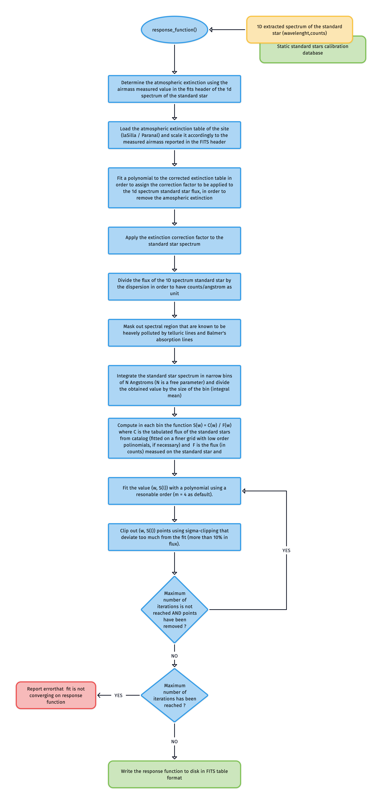
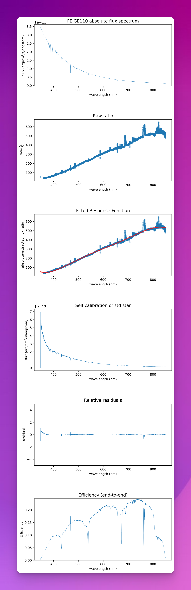

# response_function

The [`response_function`](#soxspipe.commonutils.response_function) utility computes the spectrograph's response function, using an observation of a suitable bright standard star. The function computed by this utility is used to flux calibrate the scientific spectra, converting from ADU to $erg$ $cm^{-2} s^{-1} A^{-1}$.

The general algorithm and steps performed by [`response_function`](#soxspipe.commonutils.response_function) are reported in the {numref}`response_function_util`.

:::{figure-md} response_function_util
{width=600px}

The algorithm used to compute the spectrograph's response function.
:::

In detail, this utility first takes the airmass at which the standard star was observed. The recipe passes it in: it is the same mean airmass that [`flux_calibration`](flux_calibration.md) uses, over every raw frame that contributes to the standard's extraction (all frames of a stare stack, the A and B frames of a nod, and only the ON frames of an offset). A UVB or VIS standard with no known airmass stops with an error. Then, it loads the standard extinction curve, supplied as a FITS table with wavelength and $mag_{airmass}$ for the observing site (La Silla for NTT/SOXS), and corrects the observed flux (in counts) accordingly, applying the formula:

$$
fluxCorrected_{\lambda} = fluxObserved_{\lambda} \times 10^{AM \times mag_{airmass}}
$$

Please note that the tabulated extinction curve and the observed spectrum are fitted with a nearest-neighbour interpolation schema to cope with the different discretisations.

The $fluxCorrected_{\lambda}$ values are the flat-fielded `FLUX_COUNTS` of the standard star, divided by the detector binning along the dispersion axis (`ESO DET BINY` on the VIS arm; the NIR arm is not binned) and by the value contained in the `EXPTIME` keyword of the standard star spectrum. Every raw frame that contributes to the standard star spectrum must have this same exposure time, to within 0.001 s; if they differ, the recipe stops with an error that names each frame and its exposure time. The unit is electrons s$^{-1}$ per unbinned pixel. The spectrum is not divided by the dispersion (Å per pixel): the master flat is scaled by one global level, so it keeps the dispersion of each pixel, and the flat-fielding has already divided it out. According to the considered arm (UV-VIS, NIR), regions that are known to be polluted by significant telluric absorptions or strong Lyman or Balmer/Paschen lines are masked out.

The ratio $S(\lambda) \propto C(\lambda) / F(\lambda)$ is then computed at every extracted sample, where $C(\lambda)$ is the tabulated flux of the standard star in the catalogue (in $erg$ $cm^{-2} s^{-1} A^{-1}$), and $F(\lambda)$ is the extinction-corrected flux (in counts per second) measured on the standard star.

Samples inside the telluric regions (`telluric_regions`) and within `line_half_width_nm` of the stellar lines (`stellar_lines`) are masked, as are samples with a non-finite or zero ratio. A negative ratio, from negative extracted counts in a noisy region, is kept. In each bin of `bin_width_nm` the pipeline takes the median of the inverse ratio $F(\lambda) / C(\lambda)$, which is linear in the counts. Dropping the negative samples would bias a low-signal bin towards a low response. The log of the inverse of each bin median is fitted with a cubic least-squares spline with interior knots every `knot_spacing_nm`. Knots without data on both sides are dropped so the spline bridges masked gaps.

Telluric absorption also raises the response in the wings just outside each masked band. After binning, the pipeline fits a straight line to the log response in a reference window that starts `telluric_wing_max_nm` beyond each region edge and is `telluric_wing_ref_nm` wide. It then walks outward from the edge, bin by bin, and drops every bin that is more than `telluric_wing_threshold` (and more than three times its own error) above that line. The walk stops at the first bin that is not raised, and only positive excursions count. The dropped wing bins are left out of the spline fit from the start, and the QC plot marks them as "telluric wing bins". A side with fewer than three reference bins is skipped. Set `telluric_wing_max_nm` to 0 to switch wing growth off, which is the default for the UV-blue and VIS arms.

With `smoothing_penalty` above zero, the pipeline fits a penalised cubic spline (P-spline) instead. The knots are a dense regular grid, spaced `knot_spacing_nm` apart over the kept bins. A penalty on the second difference of the spline coefficients, with weight `smoothing_penalty` times the median squared bin weight, keeps the curve smooth. In a masked gap or beyond a sparse end, no bins constrain the curve, and it tends to a straight line in log. With `smoothing_penalty` at 0, the pipeline fits the plain least-squares spline described above.

Bins are clipped in log space. Each residual is divided by the error of its bin, and the robust sigma is 1.4826 times the median absolute deviation of these scaled residuals. A noisy bin, for example at the low-signal end of an arm, is therefore judged against its own noise. Bins more than `clip_sigma_low` sigma below the spline or `clip_sigma_high` sigma above it are removed, and the fit is repeated until no bin changes or `max_iteration` is reached. The upper limit is the tighter one because absorption raises $S(\lambda)$. If the cap is reached while bins are still changing, the spline is refitted on the surviving bins and an info message is logged. If too few bins remain, `response_function` raises an exception.

The saved FITS table holds the spline response, evaluated at each extracted wavelength, in its `RESPONSE` extension. Flux calibration interpolates this curve in log space. Outside the fitted range the curve is not extrapolated, and the calibrated flux is NaN. `RESPONSE` is the only table extension. Products from earlier releases also held a table of polynomial coefficients in their first extension; it is no longer written.

The primary header of the product records the basis of the `RESPONSE` curve in the card `ESO PRO RESP BASIS = PER_UNBINNED_PIXEL`. Because of this basis, a response from an unbinned standard star also calibrates a binned science spectrum. A `RESP` file from an earlier release has no such card. The stare, nod and offset recipes check the card as soon as they find the `RESP` file in the SOF, before any extraction, and refuse the file with a message that asks you to rebuild the response from the standard star. Flux calibration checks the card again.

All settings above are per arm, in the `soxs-response` block of the settings file. A workspace settings file from an earlier release is still accepted: its `poly_order` is ignored, and any missing key is taken from the packaged defaults.

## Response curve QCs

| QC | Meaning | Tolerance setting |
| --- | --- | --- |
| `RESP BIN CLIP FRAC` | Fraction of bins clipped. | `clip_frac_max` |
| `RESP MAX GAP` | Widest stretch (nm) inside the data without a kept bin. | `max_gap_nm_max` |
| `RESP SELFCAL RES <band>` | Median of (self-calibrated flux / catalogue flux) minus 1 over the unmasked samples in the band. A positive value means the calibrated standard is too bright. | `selfcal_res_max` |

The bands come from `selfcal_bands`. A QC outside its tolerance logs an info message and adds a red note to the title of the QC plot. The recipe does not fail.

## Efficiency Calculation

:::{figure-md} response_function_eff_util
{width=600px}

The algorithm used to compute the telescope and instrument efficiency.

:::

During the computation of the response function, the `get()` method performs an evaluation of the efficiency of the instrument as the ratio between the measured counts from the observed and _not_ flat field corrected standard star spectrum and the expected number of counts from tabulated flux values of known standard stars.

In detail, the `get()` method searches the FITS header for the standard name to load the tabulated expected flux value from the static calibration assets for the observed standard star. It reads the `FLUX_DENSITY_COUNTS` column of the not-flat-fielded spectrum (the counts in each pixel divided by the width of that pixel, in electrons per nm), divides it by 10 to give electrons per Å, then divides it by the exposure time (`EXPTIME` keyword in the FITS header) and reinterpolates the tabulated standard star fluxes onto the same wavelength grid as the observed spectrum. The tabulated flux values are then converted into ph s$^{-1} cm^{-2} \AA^{-1}$ and multiplied by the effective NTT telescope area (89,000 cm$^2$). Finally, the observed standard star spectrum is divided by the tabulated standard star fluxes (adjusted as discussed above) to obtain the estimate of the end-to-end efficiency, which is smoothed using a standard Savitzky-Golay filter with $\sigma$ = 21. Only the not-flat-fielded merged spectrum has a `FLUX_DENSITY_COUNTS` column. A flat-fielded spectrum has already been divided by the dispersion through the flat, so a flux density computed from it would count the dispersion twice.

:::{figure-md} response_curve_util

The output of the `reponse_function` utility used in the reduction of spectroscopic standard star spectra. The third panel shows th fittted response curve, and the final panel shows the overall efficiency of the instrument across the entire wavelength range of the spectrograph arm. 

:::

### Utility API

:::{autodoc2-object} soxspipe.commonutils.response_function.response_function
:::
