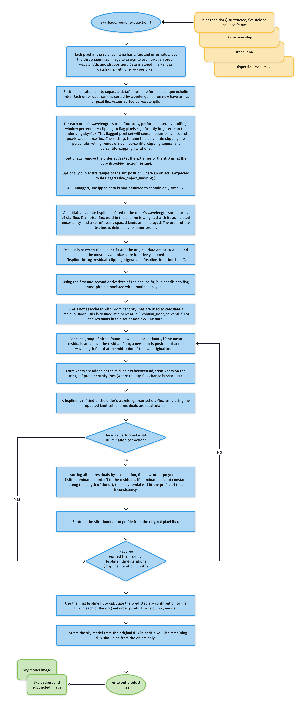
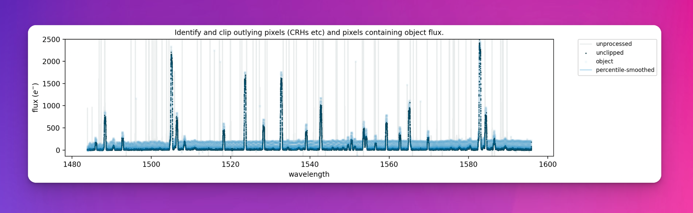
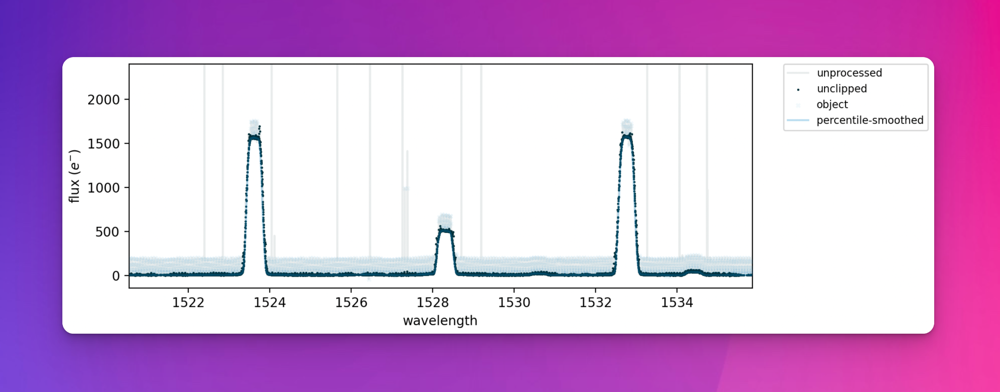
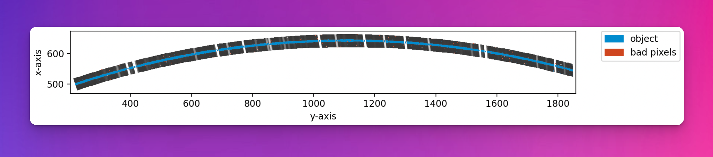
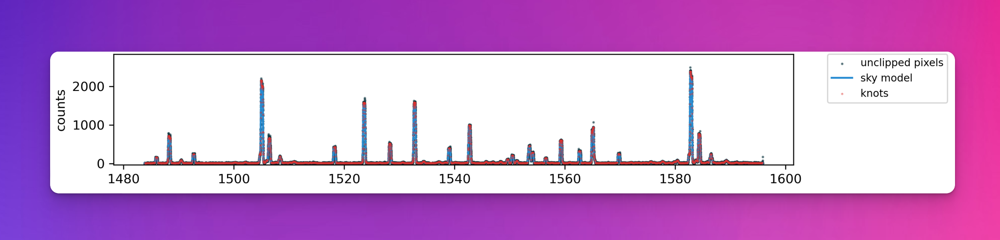
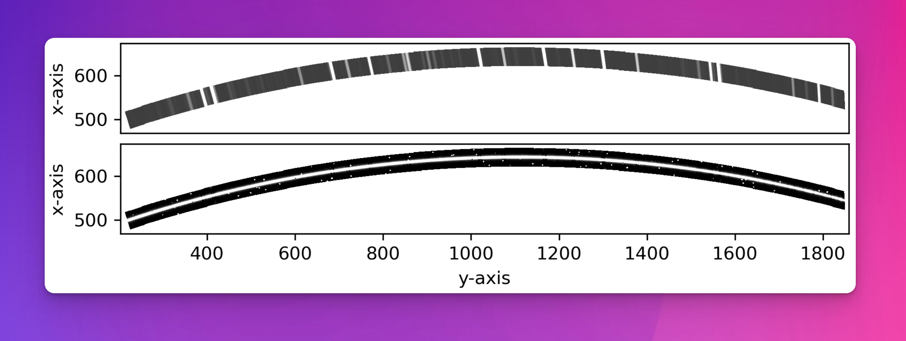

# subtract_sky

The [`subtract_sky`](#soxspipe.commonutils.subtract_sky) utility uses the on-frame data provided in a two-dimensional spectral image to accurately model the sky background, which is removed from the original data frame.

The Kelson Background Subtraction method, initially outlined in {cite:t}`kelson2003`, attempts to make optimal use of all data provided in a two-dimensional spectral image to accurately model a sky background image, which can then be removed from the original data frame. The method allows sky-subtraction to be performed in the early stages of the data-reduction process (just after flat-fielding) with no need first to identify and isolate cosmic-ray hits or other bad-pixel values.

:::{figure-md} subtract_sky_util
{width=600px}

The algorithm used to model and subtract the sky-flux from data taken in stare mode.
:::

If the recipe passes an `excludeMask`, the pixels it marks are dropped before the sky is fitted. The `soxs_stare` recipe builds this mask from the slit-illumination measurement so that the slit ends not lit in both the sky image and the master flat do not enter the sky model. With sky subtraction off, the recipe adds the same mask to a copy of the frame's mask instead. Without an `excludeMask`, no pixels are dropped.

If the recipe passes the `masterFlat` that divided the frame, the sky fit accounts for the flat. At the ends of some orders (for example in the VIS arm) the master flat falls to about 0.001. After flat division, these pixels hold large, biased values with large uncertainties. A pixel is dropped from the sky model, in the same way as an excluded pixel, when its flat is not finite, is not positive, or is below 2% of the 95th percentile of the flat in its order. The 2% limit applies to each order on its own, so a faint order is not dropped. The `soxs_stare` recipe passes the master flat when `use_flat` is on. Without a `masterFlat`, no pixels are dropped and the flat plays no part in the noise model.

Due to the curved format of each order (at least in the SOXS NIR data) and the cross-dispersion tilt of the skylines, each pixel measures flux at a slightly different wavelength to its neighbours. This provides us with an over-sampled spectrum of the sky.

The first step is to assign a wavelength, slit position and echelle order number to each detector pixel via the 2D dispersion map. Next, we flatten the data for each order to provide the over-sampled, wavelength-sorted flux array. 

An iterative rolling-window percentile smoothing with 𝜎-clipping flags pixels significantly brighter than the underlying sky flux (see {numref}`percentile_smoothing` and {numref}`percentile_smoothing_zoom`). These flagged pixels will contain cosmic-ray hits and pixels with source flux. {numref}`object_clipped_image` shows the locations of these flagged pixels on the original detector plane; the trace of the object has been successfully masked. The settings to tune this percentile clipping are  `percentile_rolling_window_size`, `percentile_clipping_sigma`, and `percentile_clipping_iterations`. 

:::{figure-md} percentile_smoothing
{width=600px}

The narrow spikes seen in the original data (grey) represent the cosmic ray hits and other bad-pixel values contaminating our measurements of the background night sky. The blue line is the percentile smoothed data (a close approximation to the sky spectrum), and the faint blue crosses are pixels flagged as containing flux other than just the sky.
:::

:::{figure-md} percentile_smoothing_zoom
{width=600px}

A zoom of the figure above. Pixels containing object flux are seen to contain flux above the background sky.
:::

:::{figure-md} object_clipped_image
{width=600px}

The original echelle order with pixels flagged as containing object flux or cosmic-ray hits marked in blue.
:::

Next, an initial univariate bspline is fitted to the order's wavelength-sorted array of sky-flux (with contaminated pixels removed). Each pixel is weighted by 1/σ, where σ² is the modelled sky flux (floored at zero) plus the square of the detector read noise, in electrons. When the master flat is known, σ is the noise of the flat-fielded pixel: a pixel with flat *f* has σ² = (modelled sky × *f* + read noise²) / *f*², so a pixel with a low flat has a low weight, and a pixel whose flat is not finite and positive has weight 0. The first fit takes the sky from a rolling-percentile estimate; each later fit takes it from the fit before. The weights never use a pixel's own measured flux, so they cannot bias the fit. A set of evenly spaced knots is employed. The order of the bspline is defined by `bspline_order`. After each fit, outliers are clipped on both sides of the fit, so isolated outliers such as cosmic-ray residuals and cold pixels are removed and the next fit is made without them. A pixel is clipped when its residual, measured from the median residual of its 25 nearest unclipped neighbours in wavelength, is more than `bspline_fitting_residual_clipping_sigma` times the noise. The noise is the same model as for the weights, with the sky taken as the fit plus that local median residual. Where the neighbouring residuals scatter more than this noise model, their robust scatter is used instead. A misfit that neighbouring pixels share, such as a skyline that the current knots do not yet resolve, is therefore left for knot insertion, not clipped. The clip starts again after each fit, so a pixel clipped by an early, coarse fit can return to a later fit. Clipped pixels are flagged `flagged_bspline_clipped`.

Using the first and second derivatives of the bspline fit, those pixels associated with prominent skylines are flagged. The same noise model is used to find noisy regions: the long rolling median of the residual is measured in units of σ, so a region where the flat is low is not called noisy only because its flat-fielded noise is larger in electrons. Pixels *not* associated with prominent skylines are used to calculate a 'residual floor'. This is defined at a percentile (`residual_floor_percentile`) of the residuals in this set of non-sky-line data. For each group of pixels found between adjacent knots, if the mean residuals are above the residual floor, a new knot is positioned at the wavelength found at the mid-point of the two original knots. Extra knots are also added at the mid-points between adjacent knots on the wings of prominent skylines (where the sky-flux change is sharpest). 

A bspline is refitted to the order's wavelength-sorted sky-flux array using the updated knot set, and residuals are recalculated.

A final round of iterative bspline fitting is performed, each time adding new knots at locations where the residuals exceed the residual floor determined earlier and at the wings of prominent skylines. This continues until the bspline fitting iteration limit (`bspline_iteration_limit`) is reached. With the final knots, the bspline is then refitted without the clipped pixels, clipped again and refitted, until a pass clips no new pixel or after five refits. {numref}`bspline_fit` shows the final bspline fit that is used as the sky model.

:::{figure-md} bspline_fit
{width=600px}

A bspline fit of the sky spectrum. The black dots are the sky flux values coming from individual pixels, the red diamonds are the strategically placed knot, and the blue line is the final bspline fit to the data (the sky model).
:::

Finally, this bspline fit is used to generate an estimation of the sky flux level in every pixel in the original detector space (top panel of {numref}`sky_model_image`), which is then subtracted from the original image to produce a sky-subtracted frame ready for object extraction.

:::{figure-md} sky_model_image
{width=600px}

The bspline fit is used to estimate the sky flux level in every pixel in the original detector space (top panel), which is then subtracted from the original image to produce a frame with the sky removed (bottom panel). The object trace can be clearly seen now the skylines have been removed.
:::

The uncertainties written with the products are not yet a full error budget:

- The `ERRS` extension of the sky-model product (`SKYMODEL`) is a copy of the object frame's uncertainty. It is not the uncertainty of the model.
- The `ERRS` extension of the sky-subtracted product (`SKYSUB`) is the object frame's uncertainty. It does not include the uncertainty of the sky model.

### Object-wing correction

The sky model is a bspline in wavelength only. Light from the wings of a bright object, outside the object mask, can therefore enter the fit. The sky model then carries some object light, and the pipeline subtracts that light from the object. This matters most for bright objects such as standard stars, and most in the blue orders where the sky is faint.

After the first fit of an order, the pipeline measures the spatial profile of the residual (the flux minus the first sky fit). It bins the profile in 0.25 arcsec slit bins, in units of the object's core spectrum. It uses only the pixels that the first fit used, not the clipped pixels. The pipeline takes the faintest 1 arcsec of the profile to hold no object light, and this sets the zero point of the profile.

If the zero point is negative, the first fit holds object light. The pipeline corrects the order when this light is above `object_wing_gate_fraction` of the sky level (default 0.1) and above 5 times its noise. It then subtracts the wing model from the sky pixels and refits the sky. The flux in the output is not changed, because only the sky model changes. The log reports each corrected order. An order that fails either test keeps the first fit.

This method cannot tell light that is constant along the whole slit from sky. It assumes that the faintest 1 arcsec of the slit has no object light.

On a crowded slit that assumption fails, because light from the other sources fills the faintest 1 arcsec. So the pipeline also counts the sources in the profile of all usable pixels. A source is a peak whose prominence is more than 5 times the noise of its bin and more than 0.2 of the profile's maximum above its median, and that is at least 1.5 arcsec from a brighter source. If an order passes the two tests above but its profile shows more than one source, the pipeline does not correct it, and the log names the order and the slit positions of the sources.

To turn the correction off, set `object_wing_correction: False` in the `sky-subtraction` block of the stare recipe settings. A workspace settings file that does not have these keys uses the defaults: the correction is on and the gate fraction is 0.1.

### Utility API

:::{autodoc2-object} soxspipe.commonutils.subtract_sky.subtract_sky
:::

