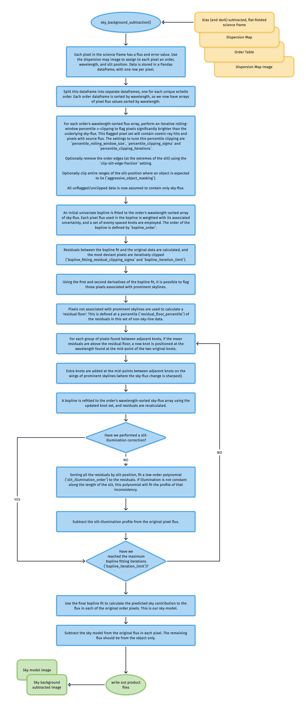
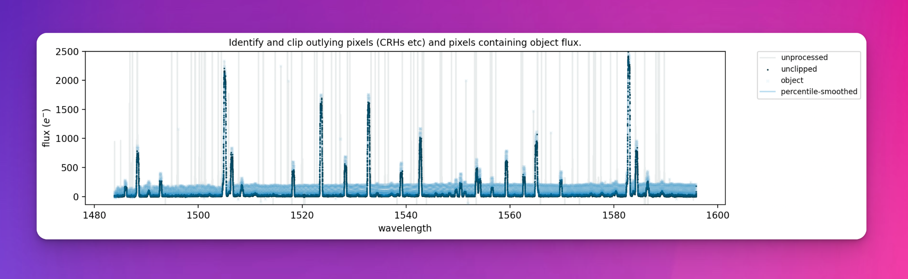
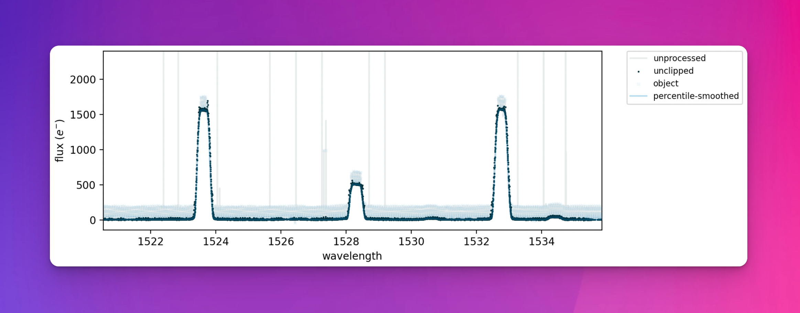
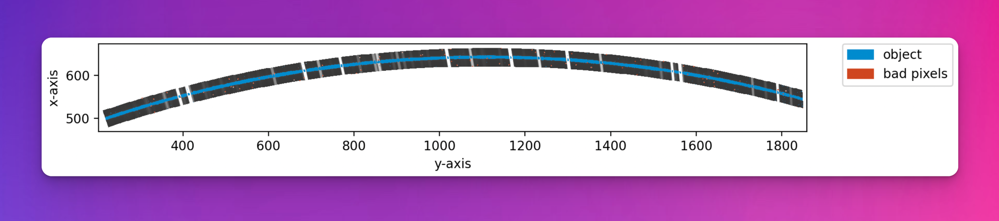
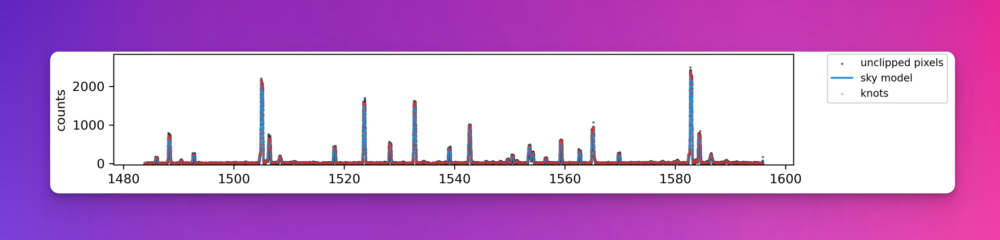
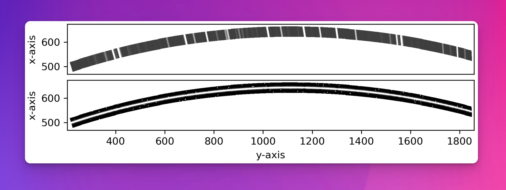

# subtract_sky

The [`subtract_sky`](#soxspipe.commonutils.subtract_sky) utility uses the on-frame data provided in a two-dimensional spectral image to accurately model the sky background, which is removed from the original data frame.

The Kelson Background Subtraction method, initially outlined in {cite:t}`kelson2003`, attempts to make optimal use of all data provided in a two-dimensional spectral image to accurately model a sky background image, which can then be removed from the original data frame. The method allows sky-subtraction to be performed in the early stages of the data-reduction process (just after flat-fielding) with no need first to identify and isolate cosmic-ray hits or other bad-pixel values.

:::{figure-md} subtract_sky_util
{width=600px}

The algorithm used to model and subtract the sky-flux from data taken in stare mode.
:::

If the recipe passes an `excludeMask`, the pixels it marks are dropped before the sky is fitted. The `soxs_stare` recipe builds this mask from the slit-illumination measurement so that the slit ends not lit in both the sky image and the master flat do not enter the sky model. With sky subtraction off, the recipe adds the same mask to a copy of the frame's mask instead. Without an `excludeMask`, no pixels are dropped.

If the recipe passes the `masterFlat` that divided the frame, the sky fit accounts for the flat. At the ends of some orders (for example in the VIS arm) the master flat falls to about 0.001. After flat division, these pixels hold large, biased values with large uncertainties. A pixel is dropped from the sky model, in the same way as an excluded pixel, when its flat is not finite, is not positive, or is below 2% of the 95th percentile of the flat in its order. The 2% limit applies to each order on its own, so a faint order is not dropped. The `soxs_stare` recipe passes the master flat when `use_flat` is on. Without a `masterFlat`, no pixels are dropped and the flat plays no part in the noise model.

Due to the curved format of each order (at least in the SOXS NIR data) and the cross-dispersion tilt of the skylines, each pixel measures flux at a slightly different wavelength to its neighbours. This provides us with an over-sampled spectrum of the sky.

The first step is to assign a wavelength, slit position and echelle order number to each detector pixel via the 2D dispersion map. Next, we flatten the data for each order to provide the over-sampled, wavelength-sorted flux array. 

An iterative rolling-window percentile smoothing with 𝜎-clipping flags pixels significantly brighter than the underlying sky flux (see {numref}`percentile_smoothing` and {numref}`percentile_smoothing_zoom`). These flagged pixels will contain cosmic-ray hits and pixels with source flux. {numref}`object_clipped_image` shows the locations of these flagged pixels on the original detector plane; the trace of the object has been successfully masked. The settings to tune this percentile clipping are  `percentile_rolling_window_size`, `percentile_clipping_sigma`, and `percentile_clipping_iterations`. 

:::{figure-md} percentile_smoothing
{width=600px}

The narrow spikes seen in the original data (grey) represent the cosmic ray hits and other bad-pixel values contaminating our measurements of the background night sky. The blue line is the percentile smoothed data (a close approximation to the sky spectrum), and the faint blue crosses are pixels flagged as containing flux other than just the sky.
:::

:::{figure-md} percentile_smoothing_zoom
{width=600px}

A zoom of the figure above. Pixels containing object flux are seen to contain flux above the background sky.
:::

:::{figure-md} object_clipped_image
{width=600px}

The original echelle order with pixels flagged as containing object flux or cosmic-ray hits marked in blue.
:::

Next, an initial univariate bspline is fitted to the order's wavelength-sorted array of sky-flux (with contaminated pixels removed). Each pixel is weighted by 1/σ, where σ² is the modelled sky flux (floored at zero) plus the square of the detector read noise, in electrons. When the master flat is known, σ is the noise of the flat-fielded pixel: a pixel with flat *f* has σ² = (modelled sky × *f* + read noise²) / *f*², so a pixel with a low flat has a low weight, and a pixel whose flat is not finite and positive has weight 0. The first fit takes the sky from a rolling-percentile estimate; each later fit takes it from the fit before. The weights never use a pixel's own measured flux, so they cannot bias the fit. A set of evenly spaced knots is employed. The order of the bspline is defined by `bspline_order`. After each fit, outliers are clipped on both sides of the fit, so isolated outliers such as cosmic-ray residuals and cold pixels are removed and the next fit is made without them. A pixel is clipped when its residual, measured from the median residual of its 25 nearest unclipped neighbours in wavelength, is more than `bspline_fitting_residual_clipping_sigma` times the noise. The noise is the same model as for the weights, with the sky taken as the fit plus that local median residual. Where the neighbouring residuals scatter more than this noise model, their robust scatter is used instead. A misfit that neighbouring pixels share, such as a skyline that the current knots do not yet resolve, is therefore left for knot insertion, not clipped. The clip starts again after each fit, so a pixel clipped by an early, coarse fit can return to a later fit. Clipped pixels are flagged `flagged_bspline_clipped`.

Using the first and second derivatives of the bspline fit, those pixels associated with prominent skylines are flagged. The same noise model is used to find noisy regions: the long rolling median of the residual is measured in units of σ, so a region where the flat is low is not called noisy only because its flat-fielded noise is larger in electrons. Pixels *not* associated with prominent skylines are used to calculate a 'residual floor'. This is defined at a percentile (`residual_floor_percentile`) of the residuals in this set of non-sky-line data. For each group of pixels found between adjacent knots, if the mean residuals are above the residual floor, a new knot is positioned at the wavelength found at the mid-point of the two original knots. Extra knots are also added at the mid-points between adjacent knots on the wings of prominent skylines (where the sky-flux change is sharpest). 

A bspline is refitted to the order's wavelength-sorted sky-flux array using the updated knot set, and residuals are recalculated.

A final round of iterative bspline fitting is performed, each time adding new knots at locations where the residuals exceed the residual floor determined earlier and at the wings of prominent skylines. This continues until the bspline fitting iteration limit (`bspline_iteration_limit`) is reached. With the final knots, the bspline is then refitted without the clipped pixels, clipped again and refitted, until a pass clips no new pixel or after five refits. {numref}`bspline_fit` shows the final bspline fit that is used as the sky model.

:::{figure-md} bspline_fit
{width=600px}

A bspline fit of the sky spectrum. The black dots are the sky flux values coming from individual pixels, the red diamonds are the strategically placed knot, and the blue line is the final bspline fit to the data (the sky model).
:::

Finally, this bspline fit is used to generate an estimation of the sky flux level in every pixel in the original detector space (top panel of {numref}`sky_model_image`), which is then subtracted from the original image to produce a sky-subtracted frame ready for object extraction.

:::{figure-md} sky_model_image
{width=600px}

The bspline fit is used to estimate the sky flux level in every pixel in the original detector space (top panel), which is then subtracted from the original image to produce a frame with the sky removed (bottom panel). The object trace can be clearly seen now the skylines have been removed.
:::

The uncertainties written with the products are not yet a full error budget:

- The `ERRS` extension of the sky-model product (`SKYMODEL`) is a copy of the object frame's uncertainty. It is not the uncertainty of the model.
- The `ERRS` extension of the sky-subtracted product (`SKYSUB`) is the object frame's uncertainty. It does not include the uncertainty of the sky model. For the NIR arm, the pipeline scales it by the scatter of the sky-fit residuals (see [Sky-residual error inflation](#sky-residual-error-inflation)).

### Sky-residual error inflation

The sky model is a bspline in wavelength only. It can not follow every detail of a bright skyline, so the sky-subtracted frame keeps a residual at each skyline. The residual is the same in all pixels of the slit at one wavelength. The object frame's uncertainty has no term for this residual. The optimal extraction therefore gives each skyline residual error bars that are too small, and the residual shows in the spectrum as a spike many times larger than its stated error.

To correct the error bars, the pipeline measures the residual of each order after the sky fit:

1. For each pixel that the sky fit used, it computes r = (flux − sky model) / error. Clipped pixels, such as pixels of the object or of cosmic rays, are not used.
2. It sorts the pixels by wavelength and measures the scatter of r in a rolling window of 100 pixels. The scatter is 1.4826 times the median absolute deviation (MAD) of r. The MAD is not changed by a few outliers.
3. The factor k(λ) is the larger of 1 and this scatter. The pipeline never makes an error smaller.
4. It multiplies the `ERRS` value of every pixel of the order by k(λ).

Where the sky model fits well, r is noise with a scatter of 1 and the errors do not change. At a skyline with a residual, r has a larger scatter and the errors grow by the same factor.

The inflation changes only the `ERRS` extension of the sky-subtracted product (`SKYSUB`). The data, the sky model and the residuals product are not changed. An order with fewer than 30 usable pixels is not inflated, and neither is an order that is too bright to be modelled.

The `sky_error_inflation` setting in the `sky-subtraction` block of the stare recipe settings turns the inflation on or off. It must be `True` or `False`. A workspace settings file that does not have the key uses the default: on for the NIR arm and off for the VIS arm. The VIS default is off because its effect on the VIS arm is not yet measured.

### Object-wing correction

The sky model is a bspline in wavelength only. Light from the wings of a bright object, outside the object mask, can therefore enter the fit. The sky model then carries some object light, and the pipeline subtracts that light from the object. This matters most for bright objects such as standard stars, and most in the blue orders where the sky is faint.

After the first fit of an order, the pipeline measures the spatial profile of the residual (the flux minus the first sky fit). It bins the profile in 0.25 arcsec slit bins, in units of the object's core spectrum. It uses only the pixels that the first fit used, not the clipped pixels. Of these, it uses only the pixels whose sky model is at or below the order's median sky, because a slit illumination error grows with the sky and the object light does not. The pipeline takes the profile more than 3 arcsec from the object to hold no object light. The mean of the profile there, on both sides of the object, is the zero point of the profile.

The wing profile is not the same at every wavelength of an order. On a bright NIR standard (order 12), the wings were wider at the red end than at the blue end, for a reason not yet known. Next to the object mask, the single-profile model was about 2 times the measured wing light at the blue end of the order and 0.6 to 0.7 times it at the red end. One profile therefore took too much sky at the blue end and too little at the red end (DY-2079). The pipeline therefore no longer uses one profile for the whole order. The wing model at a pixel is the core spectrum times a profile that changes with wavelength: a straight-line interpolation between up to 6 profiles. Each profile is measured as above, with its own zero point, from the pixels near its own wavelength. The wavelengths are the medians of 6 equal shares of the pixels in the profile, so each profile sits where it was measured. Beyond the last wavelength the last profile applies. A chunk takes the profile of the whole order when its zero point is not below 0 by more than 5 times its own noise, or when, on one side of the object, the whole-order profile has a bin more than 3 arcsec from the object and the chunk has none. The log says how many chunks of an order did this. The thermal NIR order is the exception: an order whose median usable wavelength is above 1900 nm keeps the single profile of the whole order, as before this change. The rule tests only the wavelength, so it also applies to the X-Shooter NIR orders above 1900 nm (about orders 11 to 13). The thermal sky rises steeply to the red in that order, so the faint-sky pixels that the profile is measured from all sit in the blue half of the order, and the red part has none. Whether the chunked profile or the single profile is the right correction there is not yet known (DY-2120). The log says when an order used the single profile for this reason. The gating tests in the next paragraph use the single profile of the whole order.

If the zero point is negative, the first fit holds object light. The pipeline corrects the order when this light is above `object_wing_min_leak_sigma` times the noise of a faint-sky pixel (default 0.03) and above 5 times its own noise. It then subtracts the wing model from the sky pixels and refits the sky. The correction changes only the sky model, so the extracted flux changes only through the sky. The log reports each corrected order. An order that fails any of these tests keeps the first fit. The pipeline also does not correct an order whose sky is too faint: the median of its sky model must be above `object_wing_min_sky_sigma` times the same noise (default 1). In a near-zero-sky NIR order the correction would drive the sky model negative. The log names such an order and the reason.

This method cannot tell light that is constant along the whole slit from sky. It assumes that the slit more than 3 arcsec from the object has no object light. Where the object's wings reach further, for example on a wide slit with a very bright star, the light beyond 3 arcsec stays in the sky model. Before DY-1964 the zero point was the faintest 1 arcsec of the profile. That choice picked a dim slit end or the low side of a sloping profile, so the correction took too much light out of the sky model.

On a crowded slit that assumption fails, because light from the other sources fills the far slit. So the pipeline also counts the sources in the profile of all usable pixels. A source is a peak whose prominence is more than 5 times the noise of its bin and more than 0.2 of the profile's maximum above its median, and that is at least 1.5 arcsec from a brighter source. If an order passes the two tests above but its profile shows more than one source, the pipeline does not correct it, and the log names the order and the slit positions of the sources.

The pipeline also does not correct an order whose sky is brighter than the core spectrum. For this test it takes the median of the sky model divided by the core spectrum, S/G, over the profile pixels that have a positive core spectrum. The zero point is in units of the core spectrum, so where S/G is large, a small mismatch in the slit illumination or a small pedestal (a constant offset in the residual) moves it as much as real object light does. Order 10 of the NIR arm, where the thermal sky is 8 to 14 times the core spectrum of a standard in the water band, is the case that was found (DY-2120). On the bright standards, the orders that were corrected correctly have an S/G of 0.02 to 0.33. If S/G is above 1, the pipeline does not correct the order, and the log names the order and the S/G. This test runs after the crowded-slit test, so an order that fails both is reported as crowded.

To turn the correction off, set `object_wing_correction: False` in the `sky-subtraction` block of the stare recipe settings. A workspace settings file that does not have these keys uses the defaults: the correction is on, `object_wing_min_leak_sigma` is 0.03 and `object_wing_min_sky_sigma` is 1. A workspace settings file made before DY-1964 may still hold `object_wing_gate_fraction`. The pipeline ignores it.

### Along-slit illumination from the master flat

The sky model is a bspline in wavelength only, but the sky in a flat-fielded NIR frame is not the same at every slit position. The lamp that makes the master flat lights the slit bottom about 0.35 %/arcsec more than the sky does. The frame is divided by that flat, so the sky looks fainter at the slit bottom and brighter at the slit top. A model in wavelength alone leaves this gradient in the sky-subtracted frame. It was present in all 40 NIR stare frames that were measured, on four slit widths (DY-1990).

The `flat-slit-gradient` setting takes this gradient from the master flat. For each order, the pipeline does these steps:

1. It takes the range of the slit where both the sky image and the master flat are lit, less the `overlap-margin-arcsec` margin. An order with no usable slit offset uses an offset of 0 for this range. The roll-off at the slit ends reaches about 0.45 arcsec inside the lit edge of the master flat (DY-1958). The fit range is therefore the slit range less the amount by which `overlap-margin-arcsec` falls short of 0.45 arcsec, at each end. The shipped margin of 0.45 arcsec gives no change, and a workspace that kept the older margin of 0.3 arcsec uses a fit range 0.15 arcsec narrower at each end. The fit uses only the master flat pixels inside the fit range, so the roll-off does not enter the fit. A pixel outside the fit range uses the ratio of the nearest end.
2. It splits the pixels of the order into 60 chunks of equal pixel count in wavelength. It divides each pixel by the median of the pixels of its chunk that are less than 3 arcsec from the slit centre. This removes the spectral shape of the flat. It is needed because a curved order lights different wavelengths at different slit positions, and a raw median would read the spectral shape as a gradient along the slit.
3. It bins the divided pixels in 0.1 arcsec slit bins. Each bin value is the median of the pixels in the bin. It divides the bins by the median of the bins in the middle of the range. It fits a quadratic P(s) to the bins, where s is the slit position.
4. It scales the gradient of P(s) by the factor k of the order (see the table below). The scaled profile is P_k(s) = M + k (P(s) - M), where M is the mean of P(s) over the fit range. It sets the ratio r(s) = 1 / P_k(s), and scales r(s) so that its mean over the pixels used by the sky fit is 1.
5. The sky fit divides the flux by r(s) before it fits the bspline. It multiplies the bspline by r(s) to make the sky model. The residuals that the fit uses to clip pixels, to place knots and to flag noisy regions and skylines are measured in the same divided space: (flux / r − bspline) / (error / r). The rest of the fit does not change.

The ratio is 1 for the whole order, and the log gives the reason, when:

- the sky fit has no master flat, or the order has no slit range;
- fewer than 20 slit bins hold at least 15 flat pixels each;
- the fitted profile is not positive anywhere in the slit range (the pipeline checks the two ends and the lowest point of the quadratic);
- the mean gradient of the fitted profile across the slit range is more than 1.5 %/arcsec of its mean level. A gradient this large means the flat is bad;
- the gradient of the fitted profile is more than 3 %/arcsec of its mean level anywhere in the slit range. This refuses a profile that bends sharply but has no net slope. The roll-off of a good flat toward the slit ends gives 1.5 to 2.4 %/arcsec at the ends of the range in NIR orders 10 to 22, so the limit is above that.

The log also gives the mean gradient of the master flat for each order that uses the correction, and the factor k that scales it (`scaled by k = 0.60`). The gradient in the log is the gradient of the master flat before the scaling.

The fit and the DY-1990 measurement use the same method: the same chunks and the same slit interior. They differ in the bin width (0.1 arcsec here, 0.5 arcsec in DY-1990) and in the fit window (the fit range here, |s| ≤ 5.25 arcsec in DY-1990). With the shipped margin, the fitted profile of the SLIT1.5 master flat of 2026-01-27 is within 0.35 % of the DY-1990 profile in NIR orders 10 to 19 over the slit range (DY-2147). With the older margin of 0.3 arcsec and no narrower fit range, the difference is up to 2.6 %.

The `flat-slit-gradient` setting is in the `sky-subtraction` block of the stare recipe settings. It must be `True` or `False`. Any other value stops the recipe with a `ValueError` that names the key. A settings file that does not have the key uses `False`. The default settings use `True` for the SOXS NIR arm of `soxs_stare` and `soxs_stare_std`, and `False` for the SOXS VIS arm and for X-Shooter. The VIS arm has not been checked. The `soxs_nod` and `soxs_offset` recipes do not use the setting, because they remove the sky at the same pixel and the gradient cancels.

The correction needs the slit-illumination measurement (`slit-illumination: measure-offset: True`) for the slit range of each order. Without it, the ratio is 1.

#### Scale factor k for SOXS NIR (DY-2150)

The master flat gives a good gradient in SOXS NIR orders 11 to 14. In orders 15 to 22 it gives a gradient that is about 30 to 40 % too large, so the full correction takes too much out of the sky: in orders 17 to 19 the residual slope along the slit was +0.2 %/arcsec without the correction and −0.2 %/arcsec with it. The pipeline therefore multiplies the gradient of the master flat by a fixed factor k for each SOXS NIR order. The factors are in the `flat-slit-gradient-scale` key of the `NIR` arm in `soxspipe/resources/soxs_detector_parameters.yaml`. They come from 16 NIR stare frames, on four slit widths and 12 nights in January 2026. The sky slope divided by the slope that the flat predicts gives k. An order that the key does not list, and an arm that does not have the key, use k = 1. Each order must be a whole number and each k must be above 0 and at most 1. The pipeline checks this when it starts the sky subtraction, and it stops with an error if a value is wrong.

| order | 10 to 14 | 15 | 16 | 17 | 18 | 19 | 20 to 22 | 23 and 24 |
|---|---|---|---|---|---|---|---|---|
| k | 1.00 | 0.80 | 0.75 | 0.60 | 0.70 | 0.60 | 0.60 | 1.00 |

- Orders 10 to 14 keep k = 1.00. Their under-correction is smaller than the frame-to-frame scatter of k.
- k of orders 20 to 22 has a large error, because the sky slope is poorly measured there.
- Orders 23 and 24 keep k = 1.00, because no sky slope could be measured in them.
- k is fixed. It does not change with the slit width or the night. On the 16 frames the scatter of the residual slope about this table is 0.05 to 0.10 %/arcsec in orders 15 to 19, and SLIT1.5 frames give a k that is 0.15 to 0.3 lower than SLIT1.0 frames in orders 15 to 17.
- The SOXS VIS arm and X-Shooter always use k = 1.00. The pipeline picks the table from the `INSTRUME` and `SEQ.ARM` keywords of the object frame.
- The tests that refuse a bad flat (the limits above) judge the flat before the scaling. A flat that is refused has a ratio of 1 whatever k is.

### Utility API

:::{autodoc2-object} soxspipe.commonutils.subtract_sky.subtract_sky
:::

